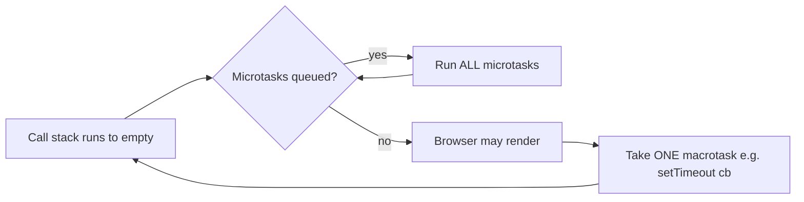

# 01 — JavaScript (from zero to interview-ready)

> **Where it lives in Root Record:** every file in `frontend/src/` is TypeScript, which is
> JavaScript plus types. Strip the types and what remains is the JavaScript taught here.

---

## 1. What & why

**JavaScript (JS)** — the only programming language browsers run natively. It started as a small
scripting language for web pages and is now used for UIs (React), servers (Node.js), build tools
(Vite) and more.

**Mental model:** JS is *single-threaded* (one line runs at a time) but *non-blocking*: slow work
(network, timers, file reads) is handed to the environment, and JS is told later when it finishes.

**Analogy:** a restaurant with **one chef** (the JS thread). The chef never stands waiting for the
oven; they put the dish in, set a timer, and cook the next order. When the timer rings, the dish
joins a queue of "things to finish".

**When NOT to use JS:** CPU-heavy number crunching (use Python/NumPy, Rust, Go or WebAssembly),
or when you need strong compile-time guarantees with no tooling (TypeScript fixes most of that).

---

## 2. Fundamentals

### 2.1 Values and types

JS has **7 primitive types** plus objects:

| Type | Example | `typeof` |
|---|---|---|
| `string` | `'Root Record'` | `"string"` |
| `number` (64-bit float) | `42`, `0.1`, `NaN` | `"number"` |
| `bigint` | `10n` | `"bigint"` |
| `boolean` | `true` | `"boolean"` |
| `undefined` | a declared-but-unset variable | `"undefined"` |
| `null` | "intentionally empty" | `"object"` (historic bug) |
| `symbol` | `Symbol('id')` | `"symbol"` |
| object (incl. arrays, functions) | `{}`, `[]`, `() => {}` | `"object"` / `"function"` |

**Primitive** — an immutable value copied by value. **Object** — a mutable collection of
properties passed *by reference* (more precisely: the reference is copied).

```js
let a = { n: 1 }
let b = a      // b points to the same object
b.n = 2
console.log(a.n) // 2
```

📍 In your project, numbers are floats, so money is converted carefully:
`frontend/src/lib/format.ts:21-23`

```ts
export function takaToMinor(taka: number): number {
  return Math.round(taka * 100)
}
```

Line-by-line: `19.99 * 100` is `1998.9999999999998` in floating point; `Math.round` fixes it to
`1999`. The test at `frontend/src/lib/format.test.ts:15-17` proves it. This is why the README says
money is stored as integer minor units (`README.md:119`).

### 2.2 Variables: `var`, `let`, `const`

| | Scope | Re-assign | Hoisted? | Use today? |
|---|---|---|---|---|
| `var` | function | yes | yes, initialised to `undefined` | no |
| `let` | block `{}` | yes | yes, but in the **TDZ** | when you must reassign |
| `const` | block `{}` | no (object contents still mutable) | yes, TDZ | default choice |

**TDZ (Temporal Dead Zone)** — the period between entering a block and the `let/const`
declaration line, during which reading the variable throws a `ReferenceError`.

📍 `frontend/src/api/client.ts:43` uses `let` because the handler is replaced later:
`let onSessionExpired: () => void = () => {}`. Almost everything else in the codebase is `const`.

### 2.3 Scope and hoisting

**Scope** — the region of code where a name is visible. JS has global, module, function and block
scope. **Hoisting** — declarations are processed before code runs, so function declarations can
be called before they appear.

```js
hello()            // works: function declarations are hoisted with their body
function hello() { console.log('hi') }

console.log(x)     // undefined (var hoisted, value not)
var x = 1

console.log(y)     // ReferenceError (TDZ)
let y = 2
```

📍 `frontend/src/pages/PatientDetailPage.tsx:193` and `:245` declare `DeletePatientDialog` and
`VisitCard` *below* the component that uses them (`:162`, `:175`). That works because they are
function declarations, hoisted to the top of the module.

### 2.4 Functions: declarations, expressions, arrows

```js
function add(a, b) { return a + b }          // declaration (hoisted)
const add2 = function (a, b) { return a + b } // expression
const add3 = (a, b) => a + b                  // arrow (implicit return)
```

Arrow functions differ: no own `this`, no `arguments`, cannot be used with `new`.

📍 The API object is a set of arrow functions: `frontend/src/api/client.ts:138-147`.

### 2.5 Equality: `==` vs `===`

`===` (strict) compares type **and** value. `==` (loose) converts types first:
`0 == ''` is `true`, `null == undefined` is `true`, `NaN === NaN` is `false`
(use `Number.isNaN`).

📍 One accepted idiom uses loose equality on purpose: `value != null` means "neither `null` nor
`undefined`". See `frontend/src/features/prescriptions/form.ts:76`:
`read?.age_years != null ? String(read.age_years) : ''`, and `frontend/src/App.tsx:91`.

### 2.6 Truthy and falsy

**Falsy** values: `false, 0, -0, 0n, '', null, undefined, NaN`. Everything else is **truthy**
(including `'0'`, `[]`, `{}`).

📍 `frontend/src/pages/PatientsPage.tsx:21`: `Number(params.get('page')) || 1` — if the param is
missing, `Number(null)` is `0` (falsy), so it falls back to page 1.
📍 `.filter(Boolean)` removes falsy entries: `frontend/src/pages/PatientsPage.tsx:70-76` builds
`"01712-345678 · 34 years · Female"` while skipping missing parts.

### 2.7 Nullish coalescing `??`, optional chaining `?.`, logical assignment

- `a ?? b` → `b` only if `a` is `null`/`undefined` (unlike `||`, keeps `0` and `''`).
- `a?.b` → `undefined` instead of throwing if `a` is null/undefined.
- `a ??= b` → assign `b` only if `a` is null/undefined.

📍 `frontend/src/api/client.ts:104` — `refreshing ??= fetch(...)` creates a refresh request only if
none is in flight (the **single-flight** pattern, §3.4).
📍 `frontend/src/lib/utils.ts:13` — `parts[0]?.[0] ?? ''` safely takes the first letter.
📍 `frontend/src/lib/image.ts:16` — `canvas.getContext('2d')?.drawImage(...)`.

### 2.8 Template literals, strings and regex

Backticks allow interpolation and multi-line strings: `` `P-${n}` ``.

📍 `frontend/src/lib/phone.ts:1-9` uses a **regular expression** (a pattern language for text):

```ts
const BD_MOBILE = /^01[3-9]\d{8}$/
function toLocal(value: string): string | null {
  let digits = value.replace(/[\s\-()]/g, '')   // drop spaces, dashes, brackets (g = all)
  if (digits.startsWith('+')) digits = digits.slice(1)
  if (digits.startsWith('880')) digits = '0' + digits.slice(3)
  return BD_MOBILE.test(digits) ? digits : null
}
```

`^` start, `01` literal, `[3-9]` one digit 3–9, `\d{8}` eight digits, `$` end.

### 2.9 Objects, arrays, destructuring, spread, rest

```js
const { id = '' } = useParams()          // object destructuring with default
const [params, setParams] = useSearchParams() // array destructuring
const copy = { ...obj, extra: 1 }        // spread: shallow copy + override
function f(...args) {}                    // rest: collect arguments
```

📍 `frontend/src/pages/PatientDetailPage.tsx:51` `const { id = '' } = useParams()`.
📍 `frontend/src/pages/PatientsPage.tsx:116` — `{ ...(q && { q }), page: String(next) }`:
spreading `false` adds nothing, so `q` is only included when non-empty. Clever but terse.
📍 `frontend/src/features/prescriptions/form.ts:99-109` uses a conditional spread to include
either `new_patient` or `patient_id`, never both.

### 2.10 Array methods you must know

| Method | Returns | Mutates? | Project example |
|---|---|---|---|
| `map` | new array of transformed items | no | `form.ts:83-89` medications → form rows |
| `filter` | new array of kept items | no | `nav.ts:39` visible nav items |
| `reduce` | single accumulated value | no | `format.ts:29-32` parts → object |
| `find` / `findIndex` | first match / its index | no | `form.ts:62`, `PrescriptionReviewPage.tsx:298` |
| `some` / `every` | boolean | no | `hooks.ts:18` any prescription still reading? |
| `includes` | boolean | no | `client.ts:119`, `permissions.ts:32` |
| `forEach` | undefined | no | `prescriptions.ts:21` append pages to FormData |
| `slice` | shallow copy of a range | no | `ScanPage.tsx:48` |
| `splice`, `push`, `sort`, `reverse` | — | **yes** | avoided in React state |
| `Array.from` | array from iterable / length | — | `DashboardPage.tsx:74` 4 skeleton rows |

📍 De-duplication by id, `frontend/src/pages/PrescriptionReviewPage.tsx:294-298`:

```ts
const options = [
  ...(p.patient ? [p.patient] : []),
  ...p.patient_matches.map((m) => ({ ...m.patient, reasons: m.reasons })),
  ...picked,
].filter((o, i, all) => all.findIndex((x) => x.id === o.id) === i)
```

Keep an item only if it is the *first* item with that id. It is O(n²) but n ≤ ~10 here, so fine.

📍 `reduce` building a lookup object, `frontend/src/lib/format.ts:25-33`:

```ts
.formatToParts(date)                          // [{type:'day', value:'25'}, ...]
.reduce<Record<string, string>>((acc, p) => {
  acc[p.type] = p.value                       // {day:'25', month:'09', year:'2026'}
  return acc
}, {})
```

### 2.11 Classes and prototypes

**Prototype** — every object has a hidden link to another object; property lookups walk this
**prototype chain**. `class` is syntax sugar over prototypes.

📍 `frontend/src/api/client.ts:15-32`:

```ts
export class ApiError extends Error {           // inherits message, stack
  readonly status: number                        // TS-only: cannot be reassigned
  readonly code: string
  readonly details: unknown
  constructor(status: number, code: string, message: string, details?: unknown) {
    super(message)                               // must call parent constructor first
    this.name = 'ApiError'                       // nicer stack traces / logs
    this.status = status
    this.code = code
    this.details = details
  }
  get fieldErrors(): ApiErrorDetail[] {          // getter: accessed like a property
    return Array.isArray(this.details) ? (this.details as ApiErrorDetail[]) : []
  }
}
```

Because it extends `Error`, code can check `err instanceof ApiError` (`App.tsx:29`,
`hooks.ts:27`).

### 2.12 `this`

`this` is decided by **how a function is called**, not where it is written:

| Call style | `this` |
|---|---|
| `obj.method()` | `obj` |
| `fn()` (strict mode / modules) | `undefined` |
| `new Fn()` | the new object |
| `fn.call(x)` / `apply` / `bind` | `x` |
| arrow function | inherited from the surrounding scope |

React function components avoid `this` entirely, which is one reason hooks replaced classes.
The only `this` in the frontend is inside `ApiError`'s constructor/getter.

---

## 3. Intermediate

### 3.1 Closures

**Closure** — a function bundled with the variables from the scope where it was created; it keeps
those variables alive after the outer function returns.

```js
function counter() {
  let n = 0
  return () => ++n
}
const next = counter()
next(); next() // 2 — `n` lives on inside the closure
```

📍 Module-level closure as a registration hook, `frontend/src/api/client.ts:43-48`:

```ts
let onSessionExpired: () => void = () => {}
export function setSessionExpiredHandler(handler: () => void): void {
  onSessionExpired = handler
}
```

`sendAuthed` (`client.ts:116-130`) closes over `onSessionExpired`. `App.tsx:89-95` registers a
handler that itself closes over `queryClient`. This avoids importing React code into the plain
fetch layer (no circular dependency).

📍 Closures in event handlers: `frontend/src/components/layout/GlobalSearch.tsx:24-33` — the
`onKey` function closes over `setOpen`.

**Classic closure bug (stale closure):** a callback captures an old value of a variable. React's
`setOpen((o) => !o)` (`GlobalSearch.tsx:28`) uses the *updater form* so it never reads a stale `o`.

### 3.2 The event loop

**Call stack** — the list of functions currently executing. **Task (macrotask) queue** —
callbacks from timers, I/O, UI events. **Microtask queue** — promise callbacks
(`.then`, `await` continuations) and `queueMicrotask`.



```js
console.log('A')
setTimeout(() => console.log('B'), 0)
Promise.resolve().then(() => console.log('C'))
console.log('D')
// A D C B
```

📍 `frontend/src/pages/PatientsPage.tsx:25-30` debounces search with `setTimeout`: each keystroke
schedules a macrotask 300 ms later and clears the previous one.

### 3.3 Promises

**Promise** — an object representing a value that will exist later. States: *pending →
fulfilled* or *pending → rejected* (settled once).

```js
fetch('/api/v1/health')
  .then((res) => res.json())
  .then((data) => console.log(data))
  .catch((err) => console.error(err))
  .finally(() => console.log('done'))
```

| Combinator | Resolves when | Rejects when |
|---|---|---|
| `Promise.all` | all fulfil (array of values) | first rejection |
| `Promise.allSettled` | all settle | never |
| `Promise.race` | first settles | first settles with rejection |
| `Promise.any` | first fulfils | all reject (`AggregateError`) |

📍 Wrapping a callback API in a promise, `frontend/src/lib/image.ts:18-20`:

```ts
const blob = await new Promise<Blob | null>((resolve) =>
  canvas.toBlob(resolve, 'image/jpeg', 0.9),   // toBlob calls resolve(blob) later
)
```

📍 Parallel work, `frontend/src/pages/ScanPage.tsx:64`:
`await Promise.all(pages.map((p) => preparePhoto(p.file)))` shrinks all pages at once.

### 3.4 async / await

`async` functions always return a promise; `await` pauses *that function* (not the thread) until
the promise settles, and throws if it rejects.

📍 `frontend/src/api/client.ts:60-79`:

```ts
async function send(path: string, opts: RequestOptions): Promise<Response> {
  const isForm = opts.body instanceof FormData
  try {
    return await fetch(buildUrl(path, opts.query), { /* ... */ })
  } catch (err) {
    if (err instanceof DOMException && err.name === 'AbortError') throw err
    throw new ApiError(0, 'network_error', t.common.networkError)
  }
}
```

- `return await` inside `try` matters: without `await`, a rejected promise would escape the
  `try/catch`.
- `fetch` only rejects on **network** failure (DNS, offline, CORS). A 404 or 500 *resolves* —
  that is why `sendAuthed` checks `res.ok` separately (`client.ts:128`).
- Abort errors are re-thrown so TanStack Query can cancel queries silently.

📍 **Single-flight refresh**, `frontend/src/api/client.ts:100-111`:

```ts
let refreshing: Promise<boolean> | null = null
function refreshSession(): Promise<boolean> {
  refreshing ??= fetch(API_BASE + '/auth/refresh', { method: 'POST', credentials: 'include' })
    .then((res) => res.ok)
    .catch(() => false)
    .finally(() => { refreshing = null })
  return refreshing
}
```

If five requests get 401 at once, all five await the **same** promise, so only one refresh call is
made. Important because the backend rotates refresh tokens and treats reuse as theft
(`backend/app/services/auth_service.py:76-83`).

### 3.5 Error handling

- `try / catch / finally`; `catch {}` without a variable is allowed (`client.ts:94`).
- `throw` any value, but throw `Error` objects (they have `stack`).
- Unhandled promise rejections are logged as errors; mark intentionally ignored promises with
  `void` (📍 `frontend/src/features/patients/hooks.ts:33` `void qc.invalidateQueries(...)`) —
  this satisfies the lint rule against floating promises and documents intent.

📍 `frontend/src/pages/ScanPage.tsx:61-71` uses `try/finally` (no catch) so `preparing` is reset
even if something throws; errors are already handled by the mutation.

### 3.6 ES modules

**ES modules (ESM)** — the standard `import`/`export` module system; each file has its own scope,
imports are live bindings, and modules execute once.

```ts
export const API_BASE = '/api/v1'          // named export
export function request() {}
import { api } from './client'             // named import
import type { User } from './types'        // TS: type-only, erased at build
import * as DialogPrimitive from '@radix-ui/react-dialog' // namespace import
```

`"type": "module"` in `frontend/package.json:5` makes Node treat `.js` files as ESM.
📍 Circular imports are avoided deliberately: `frontend/src/features/patients/hooks.ts:6-7`
re-declares `PRESCRIPTIONS_KEY` instead of importing it, because prescriptions/hooks imports
patients/hooks. On the backend the same problem is solved with a local import
(`backend/app/services/patient_service.py:124-125`).

### 3.7 Timers and cleanup

`setTimeout(fn, ms)` returns an id; `clearTimeout(id)` cancels it. 📍
`frontend/src/features/prescriptions/SharePrescription.tsx:30` revokes a blob URL one second after
starting the download, so the browser has time to begin it.

---

## 4. Advanced

### 4.1 Event loop details interviewers like

- `await x` always yields at least one microtask, even if `x` is not a promise.
- Long synchronous work blocks rendering and input → use Web Workers or chunking.
- `setTimeout(fn, 0)` is ≥ ~4 ms after nesting and runs after microtasks.
- In Node, `process.nextTick` runs before promise microtasks.

### 4.2 Memory and garbage collection

JS uses **mark-and-sweep GC**: objects unreachable from roots are freed. Leaks come from
forgotten listeners, timers, closures holding large objects, or **object URLs**.

📍 `frontend/src/pages/ScanPage.tsx:39-42` and `:53-59` call `URL.revokeObjectURL` for previews —
otherwise each photo preview (several MB) stays in memory until the tab closes.

### 4.3 Immutability

React detects change by reference, so never mutate state arrays/objects; create new ones:
📍 `frontend/src/pages/ScanPage.tsx:50` `setPages((prev) => [...prev, ...added])`,
`:57` `prev.filter((p) => p.id !== id)`.

### 4.4 Iterators, generators, `for...of`

`for...of` iterates any **iterable** (arrays, strings, Maps, Sets). 📍 `client.ts:52`:
`for (const [key, value] of Object.entries(query ?? {}))` — `Object.entries` turns an object into
`[key, value]` pairs.

### 4.5 Numbers and dates

- Floats: `0.1 + 0.2 !== 0.3`. Use integer minor units or `Intl.NumberFormat` for display.
- `Date` is always a UTC instant internally; time zones only appear when formatting.
- Numeric separators: `30_000` (`App.tsx:25`), `150_000` (`format.test.ts:8`).

📍 `frontend/src/lib/format.ts:75-78` formats a *calendar date* string by splitting it, avoiding
`new Date('2026-10-08')`, which is parsed as **UTC midnight** and could display as the previous day
in some time zones. That is a subtle, senior-level correctness choice.

### 4.6 Strict mode

ES modules are automatically in strict mode: no implicit globals, `this` is `undefined` in plain
calls, assigning to read-only properties throws.

---

## 5. Under the hood

| Topic | What really happens |
|---|---|
| **Engine** | V8 (Chrome/Edge/Node) parses JS → bytecode (Ignition) → hot code optimised to machine code (TurboFan); de-optimises if types change. |
| **Hidden classes** | Objects with the same property order share a "shape"; adding properties in random order slows property access. |
| **Event loop** | Provided by the *host* (browser or libuv in Node), not by the language itself. |
| **fetch** | Browser networking runs off the main thread; the promise resolves on a later task. |

---

## 6. Comparisons interviewers ask

| X vs Y | Key difference |
|---|---|
| `==` vs `===` | coercion vs none — always use `===` except `!= null` idiom |
| `null` vs `undefined` | intentional empty vs not-yet-set; API JSON uses `null` (`api/types.ts`) |
| `let` vs `const` vs `var` | see §2.2 |
| arrow vs regular function | lexical `this`, no `arguments`, not constructible |
| `map` vs `forEach` | returns new array vs returns undefined |
| `for...in` vs `for...of` | keys (incl. inherited) vs values of an iterable |
| `Promise.all` vs `allSettled` | fail-fast vs wait for all |
| callbacks vs promises vs async/await | nesting vs chaining vs sync-looking code |
| ESM vs CommonJS | `import` static, async, live bindings vs `require` dynamic, sync, copies |
| shallow vs deep copy | spread copies one level; `structuredClone` copies deeply |
| `??` vs `||` | only null/undefined vs any falsy |

---

## 7. Patterns & best practices / anti-patterns

**Good patterns seen here**
- Thin wrapper around `fetch` with typed errors (`api/client.ts`).
- Single-flight promise for refresh (`client.ts:101-111`).
- Pure helper functions that are easy to unit-test (`lib/format.ts`, `lib/phone.ts`).
- Constants hoisted to module scope (`format.ts:6-10` builds `Intl.NumberFormat` once — creating
  formatters is expensive).

**Anti-patterns to avoid**
- Mutating function arguments or React state.
- `async` callbacks in `forEach` (it does not wait) — use `for...of` with `await` or `Promise.all`.
- Swallowing errors with empty `catch` without a comment (here every empty catch is commented,
  e.g. `client.ts:94-96`, `image.ts:22-24`).
- Comparing floats for equality; storing money as floats.

⚠️ **Review note:** `frontend/src/features/prescriptions/form.ts:62-64` compares against the
*English sentences* the backend uses as match reasons (`'Same patient ID'`). If someone rewords the
backend string (`backend/app/services/patient_service.py:151`), pre-selection silently breaks.
Better: the API returns machine codes (`"same_code"`) and the UI translates them.

---

## 8. Security & performance

- **XSS (Cross-Site Scripting)** — injecting script into a page. React escapes text by default;
  never use `dangerouslySetInnerHTML` with user data (the project never does).
- Don't store tokens in `localStorage` (readable by any XSS). 📍 This project keeps tokens in
  **httpOnly cookies** that JS cannot read (`backend/app/api/v1/auth.py:18-37`), and the client
  only sets `credentials: 'include'` (`client.ts:65`).
- Debounce expensive work (search: `PatientsPage.tsx:25-30`).
- Avoid re-creating heavy objects in hot paths (`Intl` formatters at module level).

---

## 9. How to read JS/TS code in this repo — cheat sheet

| You see | It means |
|---|---|
| `const x = a ?? b` | `a` unless null/undefined |
| `a?.b?.()` | call `b` only if `a` and `a.b` exist |
| `x!` | TS: "trust me, not null" |
| `({ a, b }) => …` | arrow fn destructuring its single object argument (React props) |
| `...rest` | spread/rest |
| `` `text ${expr}` `` | template literal |
| `void promise` | intentionally not awaited |
| `export default` vs `export` | default vs named export (this repo uses named exports) |
| `x as T` | TS type assertion (no runtime effect) |

---

## 10. Why it was chosen here + alternatives

JS is not optional for a browser UI; the real choice was **TypeScript on top** (next module).
Alternatives for the frontend language: Dart (Flutter Web), Elm, ReScript, or WebAssembly
languages — all much smaller ecosystems and talent pools. Trade-off accepted: JS's quirks
(coercion, floats, `this`) in exchange for the largest ecosystem and React.
