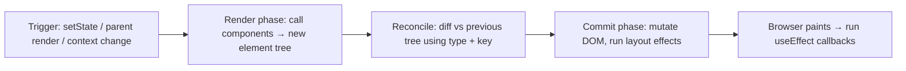
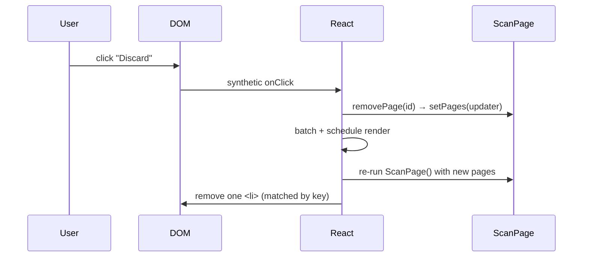

# 03 — React 18

> **Where it lives:** `frontend/src/main.tsx`, `App.tsx`, `pages/`, `features/`, `components/`.
> React version: `^18.3.1` (`frontend/package.json:26-27`).

---

## 1. What & why

**React** — a JavaScript library for building user interfaces out of **components**: functions
that take inputs (**props**) and return a description of UI (**JSX**). When data changes, React
re-runs the components and updates only the parts of the page that changed.

**Mental model:** `UI = f(state)`. You never say "add this row to the table"; you change the
data, and React works out the DOM changes.

**Analogy:** a stage play script. You write what each scene should look like for a given set of
facts; the stage crew (React) moves only the props that differ between scenes.

**When NOT to use React:** a mostly static content site (use plain HTML or a static-site
generator like Astro), very small widgets (vanilla JS), or SEO-critical public pages without a
server-rendering framework (use Next.js/Remix instead of a client-only SPA like this one).

**SPA (Single-Page Application)** — one HTML page; navigation swaps components in the browser
instead of loading new pages from the server. Root Record is an SPA (`frontend/index.html:17-18`
has one `<div id="root">` and loads `main.tsx`).

---

## 2. Fundamentals

### 2.1 Mounting the app

📍 `frontend/src/main.tsx:1-11`:

```tsx
import { StrictMode } from 'react'
import { createRoot } from 'react-dom/client'
import { App } from './App'
import './index.css'                       // Vite bundles CSS imported from JS

createRoot(document.getElementById('root')!).render(
  <StrictMode>
    <App />
  </StrictMode>,
)
```

- `createRoot` — the React 18 API that enables **concurrent rendering** features and **automatic
  batching** (multiple `setState` calls in one event → one render, even inside promises/timeouts).
- `StrictMode` — development-only checks: renders components twice and **mounts, unmounts, and
  re-mounts effects** to surface missing cleanups and impure renders. No effect in production.

### 2.2 JSX

**JSX** — HTML-like syntax inside JS that compiles to `jsx('div', { className: … })` calls
(the "new JSX transform", `tsconfig.app.json:14` `"jsx": "react-jsx"`).

Rules: one root element per return (or a **Fragment** `<>…</>`), `className` not `class`,
`htmlFor` not `for`, camelCase events (`onClick`), `{expression}` for JS values.

📍 Fragments group siblings without an extra DOM node: `frontend/src/pages/PatientsPage.tsx:35`
`<>…</>`.

### 2.3 Components and props

📍 `frontend/src/components/common/EmptyState.tsx:6-30`:

```tsx
interface EmptyStateProps {
  icon: LucideIcon
  title: string
  description?: string
  action?: ReactNode
  className?: string
}

export function EmptyState({ icon: Icon, title, description, action, className }: EmptyStateProps) {
  return (
    <div className={cn('mx-auto flex max-w-sm flex-col …', className)}>
      <div className="grid size-12 …"><Icon className="size-6" /></div>
      <h3 className="text-base font-semibold">{title}</h3>
      {description && <p className="text-sm text-muted-foreground">{description}</p>}
      {action && <div className="mt-2">{action}</div>}
    </div>
  )
}
```

- Props are **read-only** inputs.
- `icon: Icon` renames during destructuring: JSX treats lowercase tags as HTML, so a component
  stored in a variable must be Capitalised to render as `<Icon />`.
- `ReactNode` — anything renderable (string, element, array, null).
- `action` is **composition**: the caller passes any element (a button, a link) instead of
  EmptyState knowing about buttons. Used in `features/auth/guards.tsx:26`,
  `pages/NotFoundPage.tsx:15-19`.

### 2.4 Conditional rendering

| Pattern | Example |
|---|---|
| `cond && <X/>` | `EmptyState.tsx:26` |
| ternary | `pages/PatientsPage.tsx:50-108` — loading ? skeleton : data ? list : empty |
| early `return` | `pages/PatientDetailPage.tsx:64-88` loading / error states |
| `null` to render nothing | `components/common/Pagination.tsx:15` |

⚠️ Pitfall: `{count && <Badge/>}` renders `0` when count is 0. 📍
`frontend/src/pages/PrescriptionsPage.tsx:64` avoids it with `!!tab.count &&`.

### 2.5 Lists and keys

**Key** — a stable identity React uses to match list items between renders.

📍 `frontend/src/pages/PatientsPage.tsx:58-59` `items.map((patient) => <li key={patient.id}>…`.

Using the array **index** as key is fine only for static lists that never reorder.
📍 `frontend/src/pages/PatientDetailPage.tsx:255` and `:311-312` use `key={i}` for medicines and
advice — acceptable (read-only, never reordered).
📍 `frontend/src/pages/PrescriptionReviewPage.tsx:635` uses `key={field.id}` from
`useFieldArray` — necessary, because medicines can be removed from the middle; index keys would
make inputs keep the wrong values.

### 2.6 State with `useState`

**State** — data owned by a component that, when changed via its setter, triggers a re-render.

```tsx
const [drawerOpen, setDrawerOpen] = useState(false)   // components/layout/AppShell.tsx:18
```

- Setting state **schedules** a render; the variable doesn't change until the next render.
- **Updater form** for values based on the previous value:
  📍 `frontend/src/pages/ScanPage.tsx:50` `setPages((prev) => [...prev, ...added])` and
  `GlobalSearch.tsx:28` `setOpen((o) => !o)`.
- **Immutability**: create new arrays/objects; React compares by reference (`Object.is`).

📍 A tagged state instead of booleans, `frontend/src/features/prescriptions/SharePrescription.tsx:38`:
`useState<'share' | 'download' | null>(null)` — one variable expresses "idle / sharing /
downloading", which avoids impossible combos like two spinners at once.

### 2.7 Props vs state

| | Props | State |
|---|---|---|
| Owned by | parent | the component |
| Change | parent re-renders with new props | setter |
| Purpose | configure | remember |

### 2.8 Events

`onClick={() => setOpen(true)}` — pass a function, don't call it (`onClick={setOpen(true)}` would
run during render → infinite loop). 📍 `components/layout/GlobalSearch.tsx:44`.

Forms: `onSubmit` + `e.preventDefault()` (React Hook Form's `handleSubmit` does it,
`pages/LoginPage.tsx:41`).

---

## 3. Intermediate

### 3.1 `useEffect` — synchronising with the outside world

**Effect** — code that runs *after* React commits a render, used to sync with external systems
(DOM listeners, timers, subscriptions). It may return a **cleanup** function.

📍 Event listener with cleanup, `frontend/src/components/layout/GlobalSearch.tsx:24-33`:

```tsx
useEffect(() => {
  const onKey = (e: KeyboardEvent) => {
    if (e.key.toLowerCase() === 'k' && (e.ctrlKey || e.metaKey)) {
      e.preventDefault()          // stop the browser's own Ctrl+K
      setOpen((o) => !o)
    }
  }
  window.addEventListener('keydown', onKey)
  return () => window.removeEventListener('keydown', onKey)   // cleanup on unmount
}, [])                            // [] = run once after mount
```

📍 Debounce with dependencies, `frontend/src/pages/PatientsPage.tsx:24-30`:

```tsx
useEffect(() => {
  const timer = setTimeout(() => {
    if (input.trim() !== q) setParams(input.trim() ? { q: input.trim() } : {}, { replace: true })
  }, 300)
  return () => clearTimeout(timer)   // new keystroke → cancel the pending update
}, [input, q, setParams])
```

**Dependency array** rules: list every reactive value the effect reads (ESLint
`react-hooks/exhaustive-deps`, enabled at `frontend/eslint.config.js:15`). `[]` = once;
no array = after every render.

📍 Unmount-only cleanup using a ref, `frontend/src/pages/ScanPage.tsx:39-42`:

```tsx
const previews = useRef<string[]>([])
previews.current = pages.map((p) => p.preview)        // always the latest list
useEffect(() => () => previews.current.forEach((url) => URL.revokeObjectURL(url)), [])
```

The effect body does nothing; its *cleanup* runs on unmount. Reading `previews.current` (not
`pages`) avoids a **stale closure** — `pages` captured at mount would be `[]`.

**Effect pitfalls**
1. Fetching data in effects by hand (race conditions, no caching) — this project uses TanStack
   Query instead.
2. Missing cleanup → leaks/double listeners (StrictMode exposes this).
3. Deriving state in an effect (`useEffect(() => setFull(pages.length >= 6))`) — compute it
   during render instead: 📍 `ScanPage.tsx:73-74` `const full = pages.length >= MAX_PAGES`.
4. Object/array dependencies recreated every render → effect runs every render.

### 3.2 `useLayoutEffect` vs `useEffect`

| | `useEffect` | `useLayoutEffect` |
|---|---|---|
| Runs | after paint (async) | after DOM mutation, **before paint** (sync) |
| Use for | subscriptions, fetching, timers | measuring layout, preventing flicker |
| Blocks paint | no | yes |

Not used in this repo (Radix handles positioning internally).

### 3.3 `useRef`

**Ref** — a mutable box `{ current }` that persists across renders and does **not** trigger
re-renders. Two uses, both in `ScanPage.tsx:33-35`:

```tsx
const cameraInput = useRef<HTMLInputElement>(null)  // 1) DOM node handle
const nextId = useRef(0)                              // 2) mutable counter (no re-render)
…
cameraInput.current?.click()                          // open the hidden file input (:114)
{ id: nextId.current++, … }                           // unique ids for picked pages (:49)
```

### 3.4 Controlled vs uncontrolled inputs

| | Controlled | Uncontrolled |
|---|---|---|
| Source of truth | React state (`value` + `onChange`) | the DOM (`ref`, `defaultValue`) |
| Re-render per keystroke | yes | no |
| Project example | search box `PatientsPage.tsx:40-46` | React Hook Form `register` (`LoginPage.tsx:90`); file inputs `ScanPage.tsx:200-223` |

📍 `ScanPage.tsx:207-210` resets `e.target.value = ''` so picking the **same** photo twice still
fires `onChange`.

### 3.5 Lifting state up and controlled components

**Lifting state** — move state to the closest common parent so siblings can share it.

📍 `frontend/src/pages/PatientDetailPage.tsx:55-56` owns `editOpen`/`deleteOpen` and passes
`open`/`onOpenChange` to `EditPatientDialog` (`:161`) and `DeletePatientDialog` (`:162-167`). The
dialogs are **controlled components** — they display whatever the parent says.

📍 `components/layout/UserMenu.tsx:23` + `:63` — the menu item opens the password dialog by
flipping parent state.

### 3.6 Custom hooks

**Custom hook** — a function starting with `use` that calls other hooks, to share stateful logic.

📍 `frontend/src/features/auth/hooks.ts:20-41`:

```tsx
export function useCurrentUser() {
  return useQuery<User | null>({ queryKey: ME_KEY, queryFn: …, staleTime: Infinity, retry: false })
}

export function useUser(): User {
  const { data } = useCurrentUser()
  if (!data) throw new Error('useUser() called outside an authenticated route')
  return data
}
```

`useUser` gives components inside the protected shell a non-null `User`, so they don't repeat
null checks (`AppShell.tsx:19`, `Sidebar.tsx:18`, `DashboardPage.tsx:25`).

### 3.7 Rules of Hooks

1. Call hooks only at the **top level** (not in loops, conditions, or after an early `return`).
2. Call them only from components or custom hooks.

Why: React identifies hooks by **call order** per component.

📍 `frontend/src/pages/LoginPage.tsx:25-38`: all hooks (`useCurrentUser`, `useLogin`,
`useNavigate`, `useLocation`, `useState`, `useForm`) run *before* the early returns on lines 38-39.
📍 `PatientDetailPage.tsx:51-62` likewise calls `usePrescriptions` before the `isPending` return.

### 3.8 Context

**Context** — passes a value deep down the tree without prop drilling. A **Provider** supplies the
value; `useContext` reads it; every consumer re-renders when the value changes.

📍 This project consumes library contexts rather than defining its own:
`QueryClientProvider` (`App.tsx:98`), `RouterProvider` (`App.tsx:99`), `TooltipProvider`
(`AppShell.tsx:22`). Auth state is *not* in a custom context — it lives in the TanStack Query
cache under `ME_KEY` (`features/auth/hooks.ts:7`), which acts as a global store.

### 3.9 Keys to reset state

Changing a component's `key` makes React **unmount and mount a fresh instance**, discarding its
state.

📍 `frontend/src/pages/PrescriptionReviewPage.tsx:93-94`:

```tsx
// Remount when reading finishes so the form picks up what was read.
return <PrescriptionReview key={`${query.data.id}:${query.data.reading}`} prescription={query.data} />
```

`useForm({ defaultValues })` reads defaults only once; when background reading finishes
(`reading` true → false) the key changes, so the form is rebuilt with the extracted values.

### 3.10 Refs to child components: `forwardRef` and `asChild`

📍 `frontend/src/components/ui/button.tsx:37-42` wraps `<button>` in `forwardRef` so libraries
(Radix triggers, form libraries) can attach refs. `asChild` swaps the element for Radix's `Slot`,
which merges Button's props/classes into its single child — e.g. a router `<Link>` styled as a
button (`AppShell.tsx:49-54`). (React 19 lets function components accept `ref` as a normal prop.)

### 3.11 Portals

**Portal** — renders children into a different DOM node (usually `document.body`) while keeping
them in the React tree. 📍 Radix dialogs/menus use portals (`components/ui/dialog.tsx:35`,
`dropdown-menu.tsx:14`) so they escape `overflow: hidden` parents and stacking contexts.

---

## 4. Advanced

### 4.1 Rendering, reconciliation and the virtual DOM

**Render** = calling your component functions to get a new element tree.
**Reconciliation** = diffing the new tree with the previous one.
**Commit** = applying the minimal DOM changes.



Diffing heuristics: elements of a different **type** are rebuilt from scratch; children are
matched by **key**. **Fiber** — React's internal unit of work; the render phase can be paused and
resumed (concurrent rendering), the commit phase cannot.

**What causes a re-render?** (1) its state changes, (2) its parent re-renders, (3) a context it
uses changes. Props changing is a *consequence* of (2).

### 4.2 Memoization: `React.memo`, `useMemo`, `useCallback`

| API | Memoizes | When useful |
|---|---|---|
| `React.memo(C)` | a component's output (skips render if props are shallow-equal) | expensive child re-rendered by a busy parent |
| `useMemo(fn, deps)` | a computed value | expensive calculation, or stable object identity for deps |
| `useCallback(fn, deps)` | a function identity | passing callbacks to memoized children / effect deps |

📍 This codebase uses **none** of them — correct for its size: lists are paginated to 20 rows
(`PatientsPage.tsx:16`), so re-renders are cheap. Premature memoization adds complexity and its own
cost. (React 19's compiler can memoize automatically.)

### 4.3 React 18 features

| Feature | What | Used here? |
|---|---|---|
| `createRoot` | new root API | ✅ `main.tsx:7` |
| Automatic batching | batch updates everywhere | ✅ implicitly |
| `useTransition` / `startTransition` | mark updates as non-urgent | ❌ |
| `useDeferredValue` | lag a value for responsiveness | ❌ (debounce used instead) |
| `Suspense` for data / `lazy` | code-split components | ❌ |
| `useId` | stable ids for a11y | ❌ (ids are hand-written strings) |
| StrictMode double effects | dev-only | ✅ |

### 4.4 Error boundaries

**Error boundary** — a class component with `componentDidCatch`/`getDerivedStateFromError` that
catches render errors in its subtree and shows a fallback.

⚠️ **Review note:** there is no error boundary. If `useUser()` throws
(`features/auth/hooks.ts:39`) or any render crashes, React Router shows its default error element.
Add a route-level `errorElement` in `createBrowserRouter` (`App.tsx:34`) or an `ErrorBoundary`.

### 4.5 Code splitting

`React.lazy(() => import('./pages/PrescriptionReviewPage'))` + `<Suspense>` loads a page's code on
demand. ⚠️ All pages are imported eagerly (`App.tsx:12-20`); only vendor chunks are split
(`vite.config.ts:28-38`). For an internal clinic app this is fine; for a large app, lazy-load
heavy routes such as the 808-line review page.

### 4.6 Forms at scale

Controlled inputs re-render on every keystroke; React Hook Form uses uncontrolled inputs +
subscriptions so only the fields that change re-render (module 06).

### 4.7 Accessibility in React

📍 `components/common/FormField.tsx:15-31` pairs `<Label htmlFor>` with inputs and
`role="alert"` errors; `PrescriptionReviewPage.tsx:319` builds a custom radio group with
`role="radiogroup"`/`role="radio"` + `aria-checked` (`:473-476`); screen-reader-only text via
`sr-only` (`Logo.tsx:51`).

---

## 5. Under the hood: how one click flows



**Synthetic events** — React's cross-browser wrapper around native events, attached once at the
root (event delegation).

---

## 6. Comparisons interviewers ask

| X vs Y | Answer |
|---|---|
| React vs Vue | both component/VDOM; Vue has templates + built-in reactivity (fine-grained), React is "just JS" with hooks and a bigger ecosystem |
| React vs Angular | library vs full framework (DI, router, forms, RxJS built in) |
| React vs Svelte/Solid | compile-time / fine-grained signals, no VDOM; faster updates, smaller ecosystem |
| class vs function components | lifecycle methods + `this` vs hooks; hooks compose better |
| `useEffect` vs `useLayoutEffect` | §3.2 |
| `useMemo` vs `useCallback` | value vs function |
| state vs ref | re-renders vs doesn't |
| controlled vs uncontrolled | §3.4 |
| Context vs Redux/Zustand | Context = dependency injection (re-renders all consumers); stores add selectors, devtools, middleware |
| server state vs client state | data owned by the server (cache it: TanStack Query) vs UI state (useState) |
| CSR (this app) vs SSR vs SSG | browser renders vs server renders per request vs build-time HTML |

---

## 7. Patterns & best practices / anti-patterns

**Patterns in this repo**
- Feature folders: `features/<domain>/{hooks.ts, *Dialog.tsx}`.
- Page = route-level container; small presentational components (`PrescriptionRow`, `VisitCard`).
- Small helper components in the same file when only used there (`PrescriptionReviewPage.tsx`
  defines `PatientSection`, `ChoiceCard`, `PhotoViewer`, …).
- Derived values computed during render (`PrescriptionReviewPage.tsx:101-106`).

**Anti-patterns to avoid**
- Defining components *inside* other components (new type every render → remount, lost state).
- Copying props into state (`useState(props.x)`) — goes stale; use a `key` to reset instead (§3.9).
- Effects for derived data; giant components with dozens of `useState`s.

⚠️ **Review note:** `PrescriptionReviewPage.tsx` is 808 lines. It is well-sectioned, but moving
`PatientSection`, `MedicinesSection`, `PhotoViewer` into `features/prescriptions/review/` would
make each piece testable.

---

## 8. Security & performance

- React escapes interpolated strings → XSS-safe unless you use `dangerouslySetInnerHTML`.
- `href` with `javascript:` URLs is a risk; here image URLs come from the API (`image_urls`,
  `PrescriptionReviewPage.tsx:741`) and are relative paths.
- `target="_blank"` with `rel="noreferrer"` (`:741`) prevents the opened tab from accessing
  `window.opener`.
- Performance tools: React DevTools Profiler, "Highlight updates", `why-did-you-render`.

---

## 9. Reading React code — cheat sheet

| Code | Meaning |
|---|---|
| `function X({ a, b }: Props)` | component with destructured props |
| `const [v, setV] = useState(init)` | state |
| `useEffect(() => { …; return cleanup }, [deps])` | side effect |
| `useRef(null)` / `ref.current` | DOM handle / mutable box |
| `{cond && <A/>}` / `{c ? <A/> : <B/>}` | conditional |
| `list.map(x => <Row key={x.id} … />)` | list |
| `<X key={k} />` change | remount |
| `<>…</>` | fragment |
| `children` / `ReactNode` | composition |

---

## 10. Why React here + alternatives

Chosen for its ecosystem: TanStack Query, React Hook Form, Radix/shadcn, React Router all target
React first. Alternatives: Vue + Nuxt (gentler learning curve), Svelte (less code), Angular
(enterprise structure). A server-rendered app (Django templates, HTMX) would also work for an
internal clinic tool and avoid a build step, but phone-camera capture, live polling and rich forms
are easier as an SPA. Trade-off: two codebases (TS + Python) and duplicated validation.
