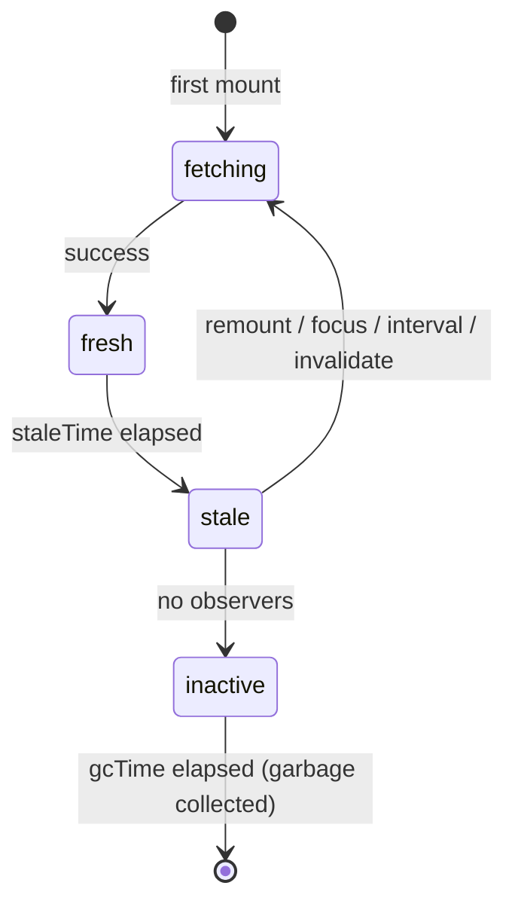

# 05 — TanStack Query 5 (React Query)

> **Where it lives:** `QueryClient` in `frontend/src/App.tsx:22-32`; hooks in
> `frontend/src/features/auth/hooks.ts`, `features/patients/hooks.ts`,
> `features/prescriptions/hooks.ts`. Version `^5.103.2` (`package.json:21`).

---

## 1. What & why

**Server state** — data that lives on the server and that the UI only *borrows* (patients,
prescriptions, the current user). It can change behind your back, needs loading/error states,
caching, de-duplication and refreshing.

**TanStack Query** — a library that manages server state: it fetches, caches by **query key**,
de-duplicates concurrent requests, refetches stale data, retries failures, and gives you
`isPending / isError / data` flags.

**Analogy:** a librarian with a card catalogue. You ask for "patients, page 2". If the book is on
the desk and recent, you get it instantly; if old, you get it *and* the librarian quietly fetches a
newer copy.

**When NOT to use it:** purely client state (open/closed dialogs → `useState`), or apps whose
framework already caches server data (Next.js RSC, Remix loaders).

---

## 2. Fundamentals

### 2.1 The client and provider

📍 `frontend/src/App.tsx:22-32, 98`:

```tsx
const queryClient = new QueryClient({
  defaultOptions: {
    queries: {
      staleTime: 30_000,            // data is "fresh" for 30 s → no refetch on remount
      refetchOnWindowFocus: false,  // don't refetch every time staff switch tabs
      // Retry only transient failures (network / 5xx), never 4xx.
      retry: (count, err) =>
        count < 2 && err instanceof ApiError && (err.status === 0 || err.status >= 500),
    },
  },
})
…
<QueryClientProvider client={queryClient}>
```

- **staleTime** — how long data counts as fresh. Default is 0 (always stale).
- **gcTime** (formerly `cacheTime`) — how long *unused* data stays in memory (default 5 min).
- The custom `retry` avoids retrying a 404/403 (pointless) but retries `status === 0` (network)
  and 5xx up to twice.

### 2.2 `useQuery`

📍 `frontend/src/features/patients/hooks.ts:11-25`:

```tsx
export function usePatients(params: PatientListParams, enabled = true) {
  return useQuery({
    queryKey: [...PATIENTS_KEY, 'list', params],     // ['patients', 'list', {q, page, page_size}]
    queryFn: ({ signal }) => patientsApi.list(params, signal),
    placeholderData: keepPreviousData,                // show old page while next loads
    enabled,                                          // don't run until allowed
  })
}

export function usePatient(id: string) {
  return useQuery({
    queryKey: [...PATIENTS_KEY, 'detail', id],
    queryFn: () => patientsApi.get(id),
  })
}
```

| Option | Meaning |
|---|---|
| `queryKey` | unique, serialisable cache key; **all inputs of queryFn must be in it** |
| `queryFn` | returns a promise; receives `{ signal }` for cancellation |
| `enabled` | run only when true (📍 `PrescriptionReviewPage.tsx:506` searches only once ≥ 2 chars) |
| `placeholderData: keepPreviousData` | keep showing the previous key's data while the new one loads — no flicker when paging/searching |
| `staleTime`, `retry`, `refetchInterval` | per-query overrides |

**Query key hierarchy** — `['patients', 'list', params]` and `['patients', 'detail', id]` share
the prefix `['patients']`, so `invalidateQueries({ queryKey: ['patients'] })` hits both.

### 2.3 Status flags

| Flag | True when |
|---|---|
| `isPending` | no data yet (first load) |
| `isFetching` | any request in flight (including background refetch) |
| `isError` / `error` | last attempt failed |
| `isSuccess` / `data` | data available |
| `isPlaceholderData` | showing `keepPreviousData` |

📍 `PatientsPage.tsx:50` shows skeletons only while `isPending`; background refetches keep the old
list visible.

### 2.4 `useMutation`

📍 `frontend/src/features/patients/hooks.ts:27-36`:

```tsx
export function useUpdatePatient(id: string) {
  const qc = useQueryClient()
  return useMutation({
    mutationFn: (body: Partial<PatientInput>) => patientsApi.update(id, body),
    onSuccess: (patient) => {
      qc.setQueryData([...PATIENTS_KEY, 'detail', id], patient)          // write-through
      void qc.invalidateQueries({ queryKey: [...PATIENTS_KEY, 'list'] })  // lists are stale
    },
  })
}
```

- `setQueryData` — put the server's response straight into the cache (no extra GET).
- `invalidateQueries` — mark matching queries stale and refetch the ones currently on screen.
- `mutate(vars, { onSuccess })` — fire-and-forget with per-call callbacks (📍 `ScanPage.tsx:65-67`
  navigates on success; `LoginPage.tsx:42`).
- `mutateAsync(vars)` — returns a promise you can `await` in `try/catch`
  (📍 `ChangePasswordDialog.tsx:52`).
- `mutation.isPending` disables buttons (📍 `ChangePasswordDialog.tsx:110`).
- `mutation.reset()` clears error state (📍 `ScanPage.tsx:46` when new photos are added).

---

## 3. Intermediate

### 3.1 Polling with `refetchInterval`

📍 `frontend/src/features/prescriptions/hooks.ts:12-37`:

```tsx
const READING_POLL_MS = 2000

export function usePrescriptions(params) {
  return useQuery({
    queryKey: [...PRESCRIPTIONS_KEY, 'list', params],
    queryFn: () => prescriptionsApi.list(params),
    placeholderData: keepPreviousData,
    refetchInterval: (query) =>
      query.state.data?.items.some((p) => p.reading) ? READING_POLL_MS : false,
  })
}

export function usePrescription(id: string) {
  const qc = useQueryClient()
  return useQuery({
    queryKey: [...PRESCRIPTIONS_KEY, 'detail', id],
    queryFn: async () => {
      const previous = qc.getQueryData<PrescriptionDetail>([...PRESCRIPTIONS_KEY, 'detail', id])
      const detail = await prescriptionsApi.get(id)
      // Reading just finished: the list's badges and fields are out of date.
      if (previous?.reading && !detail.reading) {
        void qc.invalidateQueries({ queryKey: [...PRESCRIPTIONS_KEY, 'list'] })
      }
      return detail
    },
    refetchInterval: (query) => (query.state.data?.reading ? READING_POLL_MS : false),
  })
}
```

- `refetchInterval` as a **function** = *adaptive polling*: poll every 2 s while the Gemini read
  is running (`reading: true`), stop automatically once done.
- The `queryFn` compares the previous cached value with the new one to detect the
  `reading → done` transition and refresh lists. That is the bridge between the backend's
  **background task** (`backend/app/api/v1/prescriptions.py:32`) and the UI.

Alternatives to polling: **WebSockets** or **Server-Sent Events (SSE)** — push updates from the
server. Polling is simpler and fine at clinic scale (a few drafts at once).

### 3.2 Shared "store the detail" helper

📍 `prescriptions/hooks.ts:39-45` defines `useStoreDetail()` returning a function that seeds the
detail cache and invalidates lists. Scan, read-again and save all reuse it (`:47-73`). After a
scan, the review page opens with **no loading state** because the detail is already cached.

### 3.3 Cache as global auth state

📍 `frontend/src/features/auth/hooks.ts:7-34`:

```tsx
export const ME_KEY = ['auth', 'me'] as const

export function resetSession(qc: QueryClient, user: User | null): void {
  qc.removeQueries({ predicate: (q) => q.queryKey[0] !== ME_KEY[0] })  // drop other users' data
  qc.setQueryData(ME_KEY, user)
}

export function useCurrentUser() {
  return useQuery<User | null>({
    queryKey: ME_KEY,
    queryFn: async () => {
      try { return await authApi.me() }
      catch (err) { if (err instanceof ApiError && err.status === 401) return null; throw err }
    },
    staleTime: Infinity,   // only changes on login/logout, which set it explicitly
    retry: false,
  })
}
```

- 401 becomes `null` (= "signed out", a **valid** state) instead of an error.
- On login/logout/password change, `resetSession` removes all *other* cached queries so the next
  user never sees the previous user's patients — a privacy detail.
- The comment at `hooks.ts:9-13` documents a real gotcha: `queryClient.clear()` would destroy the
  in-flight `me` query and leave `RequireAuth` stuck on its loader.

### 3.4 Cancellation

`queryFn: ({ signal }) => patientsApi.list(params, signal)` (`patients/hooks.ts:14`) passes an
**AbortSignal** to `fetch` (`api/client.ts:73`). When the key changes (user typed more), Query
aborts the outdated request; `client.ts:76` re-throws `AbortError` so it isn't shown as a network
error.

### 3.5 Invalidation map in this project

| Mutation | Updates cache | Invalidates |
|---|---|---|
| scan / read again | detail set | prescription lists |
| save prescription | detail set | prescription lists + **all** patients |
| delete prescription | detail removed | lists + patients |
| update patient | patient detail set | patient lists |
| delete patient | patient detail removed | patient lists + prescriptions |
| login / logout / change password | `me` set, everything else removed | — |

---

## 4. Advanced

### 4.1 Optimistic updates

Update the cache *before* the server answers, roll back on error:

```tsx
useMutation({
  mutationFn: update,
  onMutate: async (vars) => {
    await qc.cancelQueries({ queryKey })
    const prev = qc.getQueryData(queryKey)
    qc.setQueryData(queryKey, (old) => ({ ...old, ...vars }))
    return { prev }
  },
  onError: (_e, _v, ctx) => qc.setQueryData(queryKey, ctx?.prev),
  onSettled: () => qc.invalidateQueries({ queryKey }),
})
```

Not used here — for medical records, showing a value the server hasn't accepted is risky;
pessimistic updates (wait for the server) are the safer default.

### 4.2 Stale-while-revalidate lifecycle



### 4.3 Structural sharing

Query keeps the **same object references** for unchanged parts of new data, so components
memoised on `data.items[0]` don't re-render if that item didn't change.

### 4.4 Dependent and parallel queries

Parallel: two `useQuery`s in one component run concurrently (📍 `PrescriptionsPage.tsx:25-26`
fetches the list and the draft count). Dependent: `enabled: !!userId`. Many dynamic queries:
`useQueries`. Infinite lists: `useInfiniteQuery`.

### 4.5 Prefetching

`queryClient.prefetchQuery` on hover, or in a router loader — makes navigation instant. Not used.

---

## 5. Comparisons

| X vs Y | Answer |
|---|---|
| TanStack Query vs `useEffect + fetch` | caching, dedupe, retries, cancellation, polling vs hand-rolled race conditions |
| vs Redux Toolkit Query | similar features; RTKQ lives in Redux, endpoint definitions centralised |
| vs SWR | similar SWR model; Query has richer mutations/devtools |
| vs Apollo | Apollo is GraphQL-specific with a normalised cache |
| `invalidateQueries` vs `setQueryData` | refetch from server vs write known data |
| `isPending` vs `isFetching` | no data yet vs any request running |
| `staleTime` vs `gcTime` | freshness vs memory lifetime |
| `mutate` vs `mutateAsync` | callbacks vs promise |
| polling vs WebSockets vs SSE | simple pull vs bidirectional push vs one-way push |

---

## 6. Patterns & anti-patterns

- ✅ One hook per resource in `features/*/hooks.ts`; components never call `fetch` directly.
- ✅ Hierarchical keys with constants (`PATIENTS_KEY`).
- ✅ Adaptive polling.
- ❌ Putting server data into `useState` copies (gets stale).
- ❌ Missing variables in `queryKey` → cached data for the wrong params.
- ❌ `refetchOnWindowFocus: false` everywhere hides staleness — here acceptable because staff use
  one tab and lists refetch on navigation after 30 s.

---

## 7. Security & performance

- Clear caches between users (`resetSession`).
- Polling cost: 1 request / 2 s per open draft only while reading — bounded.
- Don't cache sensitive data in persistent storage (no `persistQueryClient` here — good).

---

## 8. Cheat sheet

```tsx
const q = useQuery({ queryKey: ['x', id], queryFn: ({ signal }) => get(id, signal), enabled, staleTime })
q.data; q.isPending; q.isFetching; q.isError; q.error; q.refetch()
const m = useMutation({ mutationFn, onSuccess, onError, onSettled })
m.mutate(vars, { onSuccess }); await m.mutateAsync(vars); m.isPending; m.reset()
const qc = useQueryClient()
qc.invalidateQueries({ queryKey: ['x'] }); qc.setQueryData(key, data); qc.getQueryData(key)
qc.removeQueries({ predicate }); qc.cancelQueries({ queryKey })
placeholderData: keepPreviousData; refetchInterval: (q) => (cond ? 2000 : false)
```

---

## 9. Why chosen + alternatives

The app is mostly "show server data, edit it, refresh". TanStack Query removes almost all
loading/caching boilerplate and enables the poll-until-read UX with two lines. Alternatives:
SWR (lighter), RTK Query (if Redux were already used), or React Router loaders.
