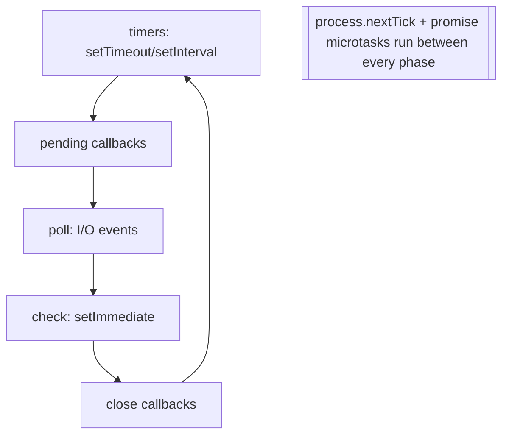

# 09 — Node.js, npm, Vite, ESLint (frontend tooling)

> **Where it lives:** `frontend/package.json`, `package-lock.json`, `vite.config.ts`,
> `eslint.config.js`, `tsconfig*.json`, `frontend/Dockerfile`, `frontend/.env.example`.

---

## 1. What & why

**Node.js** — a JavaScript runtime outside the browser (V8 engine + **libuv** for async I/O). Here
it doesn't serve the app to users; it runs **developer tools**: the Vite dev server, the
TypeScript compiler, ESLint, Vitest.

**npm** — Node's package manager: installs dependencies listed in `package.json` into
`node_modules/`, pins exact versions in `package-lock.json`, and runs `scripts`.

**Vite** — a build tool: in development it serves source files as native ES modules with instant
**HMR (Hot Module Replacement** — swapping changed modules in the running page without a reload);
for production it bundles with **Rollup** into optimised static files in `dist/`.

**ESLint** — a static analyser that flags bugs and style issues.

**Analogy:** Node is the workshop, npm the parts supplier, Vite the assembly line, ESLint the
quality inspector.

**When NOT to use Node for a backend:** CPU-bound work, or when your team/ecosystem is Python (as
here — the API is FastAPI).

---

## 2. Fundamentals

### 2.1 `package.json`

📍 `frontend/package.json:1-12`:

```json
{
  "name": "root-record-frontend",
  "private": true,               // never publish to the npm registry by accident
  "version": "0.1.0",
  "type": "module",              // .js files are ES modules
  "scripts": {
    "dev": "vite",               // dev server with HMR
    "build": "tsc -b && vite build", // type-check, then bundle
    "typecheck": "tsc -b --noEmit",
    "test": "vitest run",        // run tests once (no watch)
    "preview": "vite preview"    // serve dist/ locally
  },
```

- `dependencies` (`:13-33`) — needed by the app at runtime (bundled into the output).
- `devDependencies` (`:34-51`) — build/test tools only.
- `npm run <script>` runs a script with `node_modules/.bin` on the PATH.

### 2.2 Semantic versioning

**SemVer** — `MAJOR.MINOR.PATCH`: breaking / feature / fix.

| Range | Allows | Example |
|---|---|---|
| `^18.3.1` | `>=18.3.1 <19.0.0` | `react` (`package.json:26`) |
| `~5.8` | `>=5.8.0 <5.9.0` | `typescript` (`:47`) — TS minors can break types, so pinned tighter |
| `18.3.1` | exactly | — |

### 2.3 Lockfile and `npm ci`

`package-lock.json` records the exact resolved tree. `npm install` may update it; **`npm ci`**
installs exactly what the lockfile says and fails if it's out of sync — reproducible builds.
📍 `frontend/Dockerfile:5-6` copies only `package.json` + lockfile, then runs `npm ci` — so the
Docker layer cache skips reinstalling when only source code changes.

### 2.4 Environment variables

In Node: `process.env.NAME`. 📍 `frontend/vite.config.ts:16, 19` read `VITE_USE_POLLING` and
`VITE_PROXY_TARGET` **in the config (Node side)**. In browser code Vite exposes only variables
prefixed `VITE_` via `import.meta.env` (none are used in `src/` — the app needs no client env
vars because it calls the relative `/api/v1`).

---

## 3. Intermediate

### 3.1 `vite.config.ts` line by line

📍 `frontend/vite.config.ts:1-46`:

```ts
/// <reference types="vitest/config" />          // types for the `test` block
import path from 'node:path'                       // `node:` prefix = core module
import tailwindcss from '@tailwindcss/vite'
import react from '@vitejs/plugin-react'
import { defineConfig } from 'vite'

export default defineConfig({
  plugins: [react(), tailwindcss()],               // JSX + Fast Refresh; Tailwind compilation
  resolve: {
    alias: { '@': path.resolve(__dirname, './src') },  // `@/api/client` → src/api/client
  },
  server: {
    host: '0.0.0.0',                               // listen on all interfaces (needed in Docker)
    port: 5173,
    // File events don't cross a Windows/macOS bind mount into Docker, so poll there.
    watch: process.env.VITE_USE_POLLING === 'true' ? { usePolling: true, interval: 300 } : undefined,
    proxy: {
      '/api': {
        target: process.env.VITE_PROXY_TARGET ?? 'http://localhost:8000',
        changeOrigin: false,                       // keep Host header → cookies stay same-origin
      },
    },
  },
  build: {
    rollupOptions: {
      output: {
        // Long-lived vendor chunks cache well across app deploys.
        manualChunks: {
          react: ['react', 'react-dom', 'react-router-dom'],
          data: ['@tanstack/react-query', 'react-hook-form', 'zod', '@hookform/resolvers'],
          ui: ['@radix-ui/react-dialog', '@radix-ui/react-dropdown-menu', '@radix-ui/react-tooltip', 'cmdk', 'sonner'],
        },
      },
    },
  },
  test: { environment: 'node', include: ['src/**/*.test.ts'] },
})
```

Why the **proxy** matters: the browser talks only to `localhost:5173`; Vite forwards `/api/*` to
the backend. So the API is **same-origin** — no CORS preflights, and `SameSite=Lax` cookies work
(`docker-compose.yml:44` comment).

Why **manualChunks**: vendor code changes rarely; separate files with content hashes stay cached
by browsers when only app code changes.

📍 The alias must be declared twice — for Vite (`vite.config.ts:10`) and for TypeScript
(`tsconfig.app.json:20-21`, `tsconfig.json:4-6`).

### 3.2 Dev server vs production build

| | `vite` (dev) | `vite build` |
|---|---|---|
| Bundling | none; browser loads ESM, deps pre-bundled by esbuild | Rollup bundle, tree-shaken, minified |
| TS | esbuild strips types per file (no type check) | same; `tsc -b` runs first in `build` script |
| Output | in memory | `dist/` with hashed filenames |
| Speed | instant start, HMR | seconds |

**Tree shaking** — removing unused exports from the bundle (works because ESM imports are static).

### 3.3 ESLint flat config

📍 `frontend/eslint.config.js:7-26`:

```js
export default tseslint.config(
  { ignores: ['dist', 'node_modules'] },
  {
    extends: [js.configs.recommended, ...tseslint.configs.strict],   // JS + strict TS rules
    files: ['**/*.{ts,tsx}'],
    languageOptions: { ecmaVersion: 2022, globals: globals.browser }, // window, document…
    plugins: { 'react-hooks': reactHooks, 'react-refresh': reactRefresh },
    rules: {
      ...reactHooks.configs.recommended.rules,                       // rules-of-hooks, exhaustive-deps
      '@typescript-eslint/no-explicit-any': 'error',
      '@typescript-eslint/no-non-null-assertion': 'off',
      'react-refresh/only-export-components': ['warn', { allowConstantExport: true }],
    },
  },
  { files: ['src/components/ui/**/*.tsx'], rules: { 'react-refresh/only-export-components': 'off' } },
)
```

- **Flat config** (ESLint 9) — one JS array of config objects; replaces `.eslintrc`.
- `react-refresh/only-export-components` — Fast Refresh works best when a file exports only
  components; shadcn files also export variant helpers, so the rule is relaxed for `ui/`.

### 3.4 Node event loop (interview staple)



libuv uses a **thread pool** (default 4 threads) for file system, DNS, crypto, zlib; network I/O
uses OS non-blocking sockets.

### 3.5 Core modules

`fs` (files), `path` (📍 `vite.config.ts:2,10`), `http`, `crypto`, `os`, `url`, `stream`,
`child_process`, `events`. Prefer `node:` import prefix.

**Streams** — process data piece by piece (`fs.createReadStream(file).pipe(res)`) instead of
loading it all into memory; types: Readable, Writable, Duplex, Transform; **backpressure** stops a
fast producer overwhelming a slow consumer.

---

## 4. Advanced

- **CommonJS vs ESM** in Node: `require`/`module.exports` vs `import`/`export`; `"type":
  "module"` switches the default; `.cjs`/`.mjs` force one.
- **Peer dependencies** — a plugin says "I need React, but use the app's copy".
- **Phantom dependencies** / hoisting — importing a package you didn't declare that happens to be
  in `node_modules`; pnpm prevents this.
- **Supply-chain security** — `npm audit`, lockfiles, avoid `postinstall` scripts from unknown
  packages, pin versions, use `npm ci` in CI.
- Anonymous volume trick 📍 `docker-compose.yml:52-53`: `./frontend:/app` bind-mounts your code,
  and `/app/node_modules` mounts an anonymous volume over it so the Linux `node_modules` from the
  image isn't hidden by (or mixed with) your Windows host folder.

---

## 5. Comparisons

| X vs Y | Answer |
|---|---|
| Vite vs webpack (CRA) | native ESM dev + esbuild/Rollup (fast) vs bundle-everything dev (slow); CRA is deprecated |
| Vite vs Next.js | build tool for SPAs vs full framework with SSR/routing |
| npm vs yarn vs pnpm | default vs faster/workspaces vs content-addressed store, strict, disk-efficient |
| `npm install` vs `npm ci` | may update lockfile vs exact, clean install |
| dependencies vs devDependencies | runtime vs tooling |
| esbuild vs tsc | fast strip-only vs full type checker |
| Node vs Deno vs Bun | mature vs secure-by-default TS-native vs very fast all-in-one |
| ESLint vs Prettier | correctness rules vs formatting (Biome does both) |

---

## 6. Patterns & anti-patterns

- ✅ Scripts for every routine task; `typecheck` separate from `build`.
- ✅ Lockfile committed (`frontend/package-lock.json`); `npm ci` in Docker.
- ⚠️ The Docker image runs the **dev server** (`frontend/Dockerfile:11` `npm run dev`). For
  production, use a multi-stage build: `node` stage runs `npm run build`, then an `nginx`/`caddy`
  stage serves `dist/` with SPA fallback and proxies `/api`.
- ❌ Committing `node_modules` or `dist` (correctly ignored: `.gitignore:10-11`).

---

## 7. Security & performance

- Only `VITE_*` vars reach the browser — never put secrets in them.
- Hashed filenames + long cache headers; vendor chunk splitting.
- `npm audit` regularly; Dependabot/Renovate for updates.

---

## 8. Cheat sheet

```bash
npm ci                 # clean, exact install
npm run dev            # vite dev server
npm run build          # tsc -b && vite build → dist/
npm run typecheck      # types only
npm test               # vitest run
npx eslint src         # lint
npm outdated / npm audit
```

---

## 9. Why chosen + alternatives

Vite is the modern default for React SPAs (CRA is deprecated). npm is the zero-setup default;
pnpm would be faster with stricter dependency rules. ESLint with typescript-eslint `strict`
catches real bugs (floating promises, `any`).
