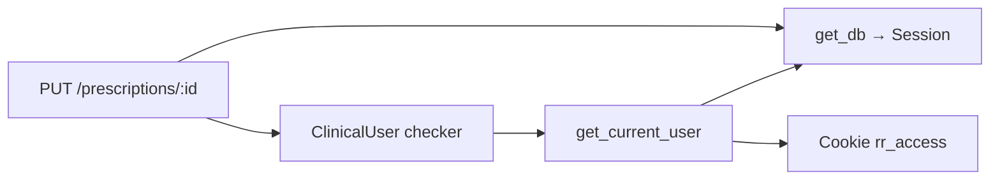
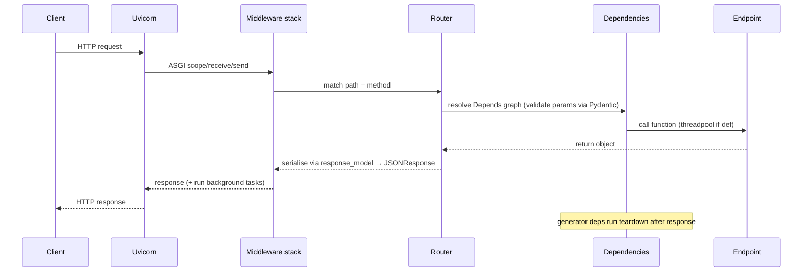

# 11 — FastAPI (+ Starlette, Uvicorn, ASGI)

> **Where it lives:** `backend/app/main.py` (app factory), `app/api/deps.py` (dependencies),
> `app/api/v1/*.py` (routers), `app/core/errors.py` (exception handlers), tests in
> `backend/tests/`. Server: Uvicorn (`backend/Dockerfile:17`).

---

## 1. What & why

**FastAPI** — a Python web framework for building HTTP APIs. You write normal functions with type
hints; FastAPI uses those hints to **parse and validate** requests (via Pydantic), **inject
dependencies**, **serialise** responses, and generate **OpenAPI** docs automatically.

**Starlette** — the lightweight ASGI toolkit FastAPI is built on (routing, requests, responses,
middleware, background tasks). **ASGI (Asynchronous Server Gateway Interface)** — the standard
interface between Python async web servers and apps (successor to WSGI). **Uvicorn** — a fast ASGI
server that runs the app.

**Analogy:** FastAPI is a receptionist who reads the visitor's form (request), checks it's filled
in correctly (validation), fetches the right file clerk (dependency), hands the job to a specialist
(your function), and returns a neatly typed reply — while keeping an up-to-date directory of all
desks (OpenAPI).

**When NOT to use:** server-rendered HTML sites with admin panels and auth built in (Django is
faster to build), or extremely high-throughput services where Go/Rust shine.

---

## 2. Fundamentals

### 2.1 The app factory

📍 `backend/app/main.py:11-35`:

```python
def create_app() -> FastAPI:
    settings = get_settings()
    logging.basicConfig(level=logging.INFO)

    app = FastAPI(
        title="Root Record API",
        version="0.1.0",
        description="Patient management for a dental clinic.",
        docs_url="/docs",              # Swagger UI
        openapi_url="/openapi.json",   # machine-readable schema
    )
    if settings.cors_origins:          # CORS only when the frontend is on another origin
        app.add_middleware(CORSMiddleware, allow_origins=settings.cors_origins,
                           allow_credentials=True, allow_methods=["*"], allow_headers=["*"])
    register_error_handlers(app)
    app.include_router(api_router)
    return app

app = create_app()                     # what `uvicorn app.main:app` imports
```

**App factory pattern** — build the app in a function so tests or alternate configs can create
fresh instances. (Tests here reuse the module-level `app` and override dependencies instead,
`tests/conftest.py:65`.)

### 2.2 Routers and path operations

📍 `app/api/v1/router.py:1-14`:

```python
api_router = APIRouter(prefix="/api/v1")       # versioned prefix
api_router.include_router(auth.router)          # /api/v1/auth/...
api_router.include_router(users.router)
api_router.include_router(patients.router)
api_router.include_router(prescriptions.router)

@api_router.get("/health", tags=["meta"])
def health() -> dict[str, str]:
    return {"status": "ok"}
```

Each domain router sets its own prefix and OpenAPI tag: `APIRouter(prefix="/patients",
tags=["patients"])` (`api/v1/patients.py:11`).

**Path operation** — an HTTP method + path + function, e.g.
`@router.get("/{patient_id}", response_model=PatientOut)` (`patients.py:38`).

### 2.3 Parameters: path, query, body, cookie, file

FastAPI decides where a parameter comes from by its type and default:

| Declaration | Source | 📍 |
|---|---|---|
| `patient_id: uuid.UUID` with `{patient_id}` in path | path (validated as UUID → 422 otherwise) | `patients.py:39` |
| `q: str \| None = Query(None, max_length=100)` | query string | `patients.py:19` |
| `status: PrescriptionStatus \| None = None` | query, validated against the enum | `prescriptions.py:41` |
| `body: PatientUpdate` (a Pydantic model) | JSON body | `patients.py:44` |
| `rr_refresh: Annotated[str \| None, Cookie()] = None` | cookie named `rr_refresh` | `auth.py:56` |
| `files: Annotated[list[UploadFile], File()]` | multipart files | `prescriptions.py:20` |
| `response: Response` | the outgoing response (set cookies) | `auth.py:46` |
| `background: BackgroundTasks` | task scheduler | `prescriptions.py:20` |

📍 Class-based query params, `schemas/common.py:20-33`:

```python
class PageParams:
    def __init__(self, page: int = Query(1, ge=1), page_size: int = Query(20, ge=1, le=100)) -> None:
        self.page = page
        self.page_size = page_size

    @property
    def offset(self) -> int:
        return (self.page - 1) * self.page_size
```

Used as `params: Annotated[PageParams, Depends()]` (`patients.py:18`) — FastAPI inspects the
class's `__init__` signature, so `?page=2&page_size=20` is validated (`page_size` max 100 prevents
"give me a million rows").

### 2.4 Response models and status codes

`@router.post("", response_model=UserOut, status_code=status.HTTP_201_CREATED)`
(`users.py:33`). **response_model** filters and validates the output: returning an ORM `User` with
`password_hash` produces JSON *without* it because `UserOut` lacks the field — asserted in
`tests/test_auth.py:15`. Endpoints annotate `-> object` (`users.py:34`) because they return ORM
objects that FastAPI converts via `from_attributes=True` (`schemas/common.py:9-10`).

`status_code=204` with `-> None` returns an empty body (`patients.py:48-51`).

### 2.5 Automatic docs

`/docs` (Swagger UI) and `/openapi.json` are generated from routes, types and docstrings. 📍 The
endpoint docstring at `prescriptions.py:22-26` ("poll the draft until `reading` is false") shows up
in the docs.

---

## 3. Intermediate

### 3.1 Dependency Injection with `Depends`

**Dependency injection (DI)** — instead of a function creating what it needs, the framework *gives*
it ready-made objects. FastAPI resolves a **dependency graph** per request, caches each dependency
once per request, and runs teardown code after the response.

📍 `app/api/deps.py:18-55`:

```python
DB = Annotated[Session, Depends(get_db)]                    # reusable alias

def get_current_user(db: DB, rr_access: Annotated[str | None, Cookie()] = None) -> User:
    payload = decode_token(rr_access, "access") if rr_access else None
    if payload is None:
        raise Unauthorized()
    user = db.get(User, uuid.UUID(payload["sub"]))
    # Checked on every request so deactivation takes effect immediately.
    if user is None or not user.is_active:
        raise Unauthorized()
    return user

CurrentUser = Annotated[User, Depends(get_current_user)]

def require_roles(*roles: UserRole) -> Callable[[User], User]:
    def checker(user: CurrentUser) -> User:
        if user.role not in roles:
            raise Forbidden()
        return user
    return checker

AdminUser = Annotated[User, Depends(require_roles(UserRole.ADMIN))]
ScanUser = Annotated[User, Depends(require_roles(UserRole.ADMIN, UserRole.DENTIST, UserRole.RECEPTIONIST))]
ClinicalUser = Annotated[User, Depends(require_roles(UserRole.ADMIN, UserRole.DENTIST))]
```



- `Annotated[T, Depends(fn)]` aliases make signatures read like plain types:
  `def save_prescription(prescription_id, body: PrescriptionSave, db: DB, user: ClinicalUser)`
  (`prescriptions.py:99-101`).
- `get_db` is used by both the endpoint and `get_current_user`, but FastAPI calls it **once per
  request** (dependency caching) — they share the same Session.
- `_: CurrentUser` (`patients.py:17`) — the underscore says "I only need this for its side effect
  (auth), not its value".
- **Dependency factory** — `require_roles(...)` returns a dependency, parameterised by roles.

**Overriding dependencies in tests** 📍 `tests/conftest.py:65` `app.dependency_overrides[get_db] =
lambda: db` swaps the real session for the test's transactional one.

### 3.2 Sync `def` vs `async def` endpoints

| | `def` endpoint | `async def` endpoint |
|---|---|---|
| Runs | in a **thread pool** (anyio, default 40 threads) | on the event loop |
| Blocking calls (sync DB, `requests`, file I/O) | ✅ OK | ❌ freezes the whole server |
| Awaiting async libraries | ❌ | ✅ |

📍 Every endpoint here is `def` because SQLAlchemy is used synchronously and the Gemini call is
sync. That is the **correct** choice for sync code. The exception handlers are `async def` because
they only build a response (`core/errors.py:72`).

### 3.3 Error handling

📍 `core/errors.py:70-107` registers four handlers:

| Handler | Catches | Returns |
|---|---|---|
| `AppError` | domain errors raised by services | their status + `{"error": {code, message, details}}` |
| `RequestValidationError` | Pydantic/param validation failures | 422 with `details: [{field, message}]` |
| `StarletteHTTPException` | 404 unknown route, 405, etc. | same envelope, mapped codes (`_HTTP_CODES`) |
| `Exception` | everything else | logs the traceback, returns a generic 500 |

📍 Field paths are cleaned (`:79-86`): `("body", "new_patient", "phone")` → `"new_patient.phone"`,
and Pydantic's `"Value error, "` prefix is removed so messages are user-ready. The test at
`tests/test_users.py:48-55` checks `{"phone", "password"}` come back as field names.

**Why a consistent envelope?** The frontend can parse every error the same way
(`frontend/src/api/client.ts:81-98`).

⚠️ Note: an `Exception` handler in FastAPI runs via Starlette's `ServerErrorMiddleware`; the
response is returned, but the exception is still re-raised for the server log — the explicit
`logger.exception` (`errors.py:104`) makes sure the traceback is logged in a known logger.

### 3.4 Cookies and the `Response` parameter

📍 `api/v1/auth.py:18-37` sets two cookies on the injected `Response`:

```python
response.set_cookie(ACCESS_COOKIE, tokens.access_token, expires=tokens.access_expires,
                    httponly=True, secure=secure, samesite="lax", path="/")
response.set_cookie(REFRESH_COOKIE, tokens.refresh_token, expires=tokens.refresh_expires,
                    httponly=True, secure=secure, samesite="lax", path=REFRESH_PATH)  # /api/v1/auth
```

FastAPI merges these headers into the final response built from `response_model`.

### 3.5 File uploads

📍 `api/v1/prescriptions.py:18-33`:

```python
@router.post("/scan", response_model=PrescriptionDetail, status_code=status.HTTP_201_CREATED)
def scan_prescription(db: DB, user: ScanUser, files: Annotated[list[UploadFile], File()],
                      background: BackgroundTasks) -> PrescriptionDetail:
    prescription_service.check_page_count(len(files))
    # Read one byte past the limit so oversized files are rejected without loading them whole.
    limit = get_settings().max_upload_mb * 1024 * 1024 + 1
    pages = [file.file.read(limit) for file in files]
    prescription = prescription_service.scan(db, user, pages)
    background.add_task(prescription_service.read_in_background, prescription.id)
    return prescription_service.to_detail(db, prescription)
```

- `UploadFile` is backed by a `SpooledTemporaryFile` (memory, then disk) — requires
  `python-multipart` (`requirements.txt:11`).
- Reading `limit` bytes (max + 1) means a 200 MB upload never fully enters Python memory; `scan()`
  then rejects any page longer than the max (`prescription_service.py:191-193`).
- ⚠️ The whole multipart body is still received and spooled by Starlette before the endpoint runs;
  a reverse proxy limit (`client_max_body_size` in nginx) should cap request size in production.

### 3.6 Background tasks

📍 `background.add_task(prescription_service.read_in_background, prescription.id)` — Starlette
runs the task **after the response is sent**, in the same process (sync functions go to the thread
pool). The user gets a draft instantly; Gemini reading (15–40 s, `README.md:10`) happens after.

Design details worth explaining in an interview:
- Pass the **id**, not the ORM object: the request's session is closed by then; the task opens its
  own session (`prescription_service.py:155`).
- A `reading_started_at` timestamp + 5-minute timeout (`:37`, `:123-125`) detects reads lost to a
  server restart.

⚠️ BackgroundTasks are fire-and-forget, in-memory, no retries, lost on crash/redeploy, and they
compete with request threads. For heavier or must-not-lose work use a **task queue** (Celery, RQ,
Arq, Dramatiq) with a broker (Redis/RabbitMQ). The timeout + "Read again" button is the pragmatic
mitigation here.

### 3.7 Returning files and raw responses

📍 `prescriptions.py:60-68` `FileResponse(path, media_type="image/jpeg", headers={"Cache-Control":
"private, max-age=86400"})` streams a file from disk. 📍 `:82-95` returns
`Response(pdf_bytes, media_type="application/pdf", headers={"Content-Disposition": 'attachment;
filename="…"', "Cache-Control": "private, no-store"})`.

### 3.8 Middleware and CORS

**Middleware** — code that wraps every request/response (logging, CORS, gzip, timing).

```python
@app.middleware("http")
async def timing(request, call_next):
    start = time.perf_counter()
    response = await call_next(request)
    response.headers["X-Elapsed"] = f"{time.perf_counter() - start:.3f}"
    return response
```

📍 The only middleware here is `CORSMiddleware`, added **only if** `CORS_ORIGINS` is set
(`main.py:22-29`), because in the normal setup the Vite proxy makes the API same-origin. With
`allow_credentials=True` the origins must be explicit (browsers reject `*` with credentials).

---

## 4. Advanced

### 4.1 Lifespan events

`@asynccontextmanager async def lifespan(app): <startup>; yield; <shutdown>` →
`FastAPI(lifespan=lifespan)`. Used for DB pools, ML models, HTTP clients. Not used here —
migrations and admin bootstrap run *before* the server in `entrypoint.sh:3-4`, and the engine is
created at import (`core/db.py:8`).

### 4.2 Request lifecycle



### 4.3 Testing with `TestClient`

`TestClient(app)` (httpx-based) calls the ASGI app in-process — no network. It keeps cookies
between requests like a browser, which the auth tests rely on (`tests/test_auth.py:61-72`). 📍
`with TestClient(app) as c:` (`tests/conftest.py:66`) also runs lifespan events.

### 4.4 Security utilities

FastAPI ships `OAuth2PasswordBearer`, `HTTPBearer`, `APIKeyCookie`, `Security()` scopes. This
project reads the cookie with `Cookie()` directly — equivalent and simpler for cookie auth, though
`APIKeyCookie` would document the scheme in OpenAPI (so Swagger's "Authorize" button would work).

### 4.5 Versioning

`/api/v1` prefix (`router.py:5`) lets a future `/api/v2` coexist.

### 4.6 Performance

- JSON serialisation via Pydantic v2 (Rust core) is fast.
- Thread pool size limits concurrent sync endpoints (~40); long Gemini calls run as background
  tasks *in that same pool*.
- Scale out with multiple Uvicorn workers (`--workers 4` or Gunicorn + Uvicorn workers).
  ⚠️ `--reload` (`Dockerfile:17`) is a dev flag: it watches files and restarts; never in
  production.

---

## 5. Comparisons

| X vs Y | Answer |
|---|---|
| FastAPI vs Flask | type-hint validation, DI, async, OpenAPI built in vs minimal core + extensions |
| FastAPI vs Django (+DRF) | API-first, lightweight vs batteries-included (ORM, admin, auth, templates) |
| FastAPI vs Express (Node) | Python + typed validation vs JS, middleware-centric |
| sync vs async endpoints | §3.2 |
| WSGI vs ASGI | sync request/response vs async, WebSockets, lifespan |
| Uvicorn vs Gunicorn | ASGI server vs process manager (often Gunicorn managing Uvicorn workers) |
| BackgroundTasks vs Celery | in-process, simple vs distributed, durable, retries |
| `Depends` vs global singletons | per-request, overridable in tests vs hidden coupling |
| `HTTPException` vs custom `AppError` | built-in vs domain-specific codes + one envelope |

---

## 6. Patterns & best practices

**Seen here**
- Thin routers → services → models (`README.md:95-98`). Routers never touch the ORM directly,
  except via services.
- `Annotated` dependency aliases (`DB`, `CurrentUser`, `AdminUser`).
- Consistent error envelope; stable machine `code`s (`"patient_code_taken"`).
- `response_model` everywhere (security: no accidental field leaks).
- Versioned prefix; health endpoint.

**Anti-patterns**
- Blocking I/O inside `async def`.
- Business logic in routers; returning ORM objects without a response model.
- Catching all exceptions and returning 200.

⚠️ **Review notes**
1. No rate limiting on `/auth/login` → brute-force possible. Add `slowapi` or a proxy rate limit.
2. `update_patient` allows any authenticated role (`patients.py:43-45`) — intended (receptionists
   fix phone numbers), matching `permissions.ts:17`, but worth confirming for clinical fields.
3. `/health` doesn't check the DB; a readiness probe should run `SELECT 1`.

---

## 7. Security & performance checklist

- AuthN in a dependency, AuthZ via role dependencies — every route declares one.
- Pydantic limits (`max_length`, `le=100`) bound input sizes.
- Upload size checks; image re-encoding strips malicious payloads.
- Generic 500 messages (no stack traces to clients).
- CORS only when needed, explicit origins.

---

## 8. Cheat sheet

```python
app = FastAPI(); router = APIRouter(prefix="/x", tags=["x"]); app.include_router(router)
@router.get("/{id}", response_model=Out, status_code=200)
def get(id: uuid.UUID, q: str | None = Query(None, max_length=100), db: DB = ..., user: CurrentUser = ...): ...
body: Model                       # JSON body
token: Annotated[str | None, Cookie()] = None
files: Annotated[list[UploadFile], File()]
background.add_task(fn, arg)
Dep = Annotated[T, Depends(fn)]; app.dependency_overrides[fn] = fake
@app.exception_handler(MyError) async def h(req, exc): return JSONResponse(...)
app.add_middleware(CORSMiddleware, allow_origins=[...], allow_credentials=True)
```

---

## 9. Why FastAPI here + alternatives

The API is JSON-only for a React SPA, needs file uploads, cookie auth, role checks and an external
AI call. FastAPI's DI makes role checks one-liners and its Pydantic integration validates every
body. Django + DRF would add an admin panel (useful for a clinic!) and built-in auth/migrations at
the cost of more framework. Flask would need many extensions to reach the same point.
