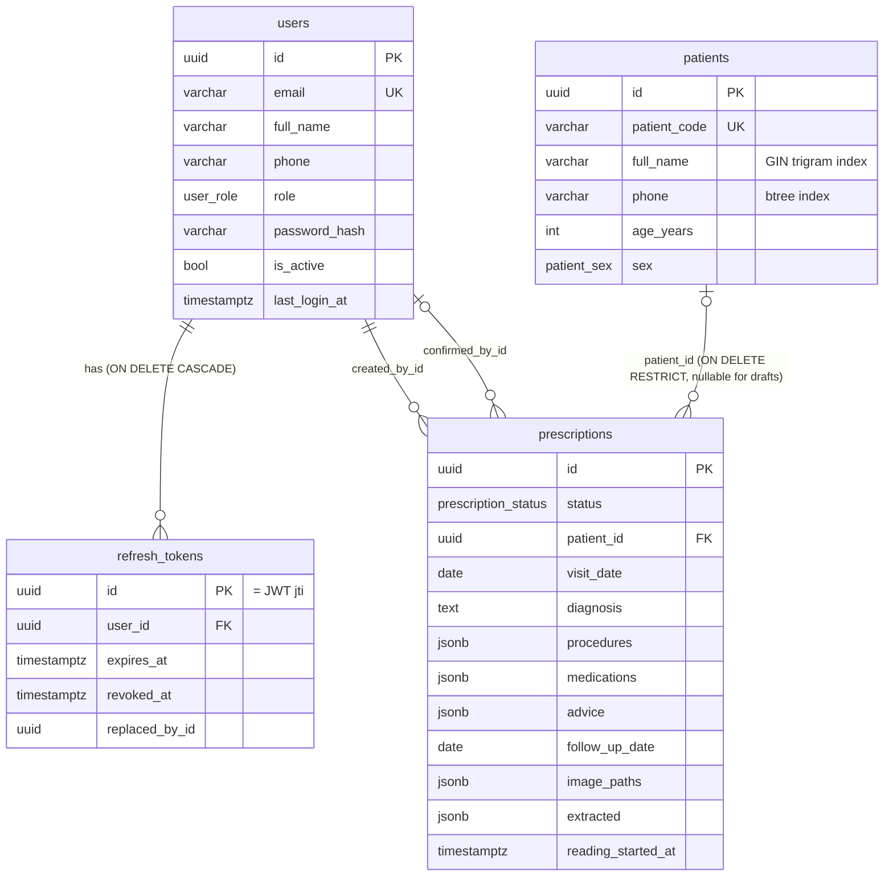

# 13 — SQL & PostgreSQL 16

> **Where it lives:** database service `docker-compose.yml:4-19` (`postgres:16-alpine`); schema in
> `backend/alembic/versions/*.py`; queries built with SQLAlchemy in `backend/app/services/*.py`.

---

## 1. What & why

**Relational database** — stores data in **tables** (rows × columns) linked by keys, queried with
**SQL (Structured Query Language)**. **PostgreSQL** — a powerful open-source relational database
with strict correctness (ACID), rich types (UUID, JSONB, arrays, enums, ranges), extensions
(`pg_trgm`), and excellent indexing.

**Analogy:** a set of spreadsheets with rules: every sheet has a column that uniquely identifies a
row, and other sheets refer to those identifiers instead of copying data.

**When NOT to use Postgres:** massive write-heavy event streams (Kafka/ClickHouse), simple
key-value caching (Redis), or document data with no relations and extreme horizontal scale
(but Postgres JSONB covers most document needs).

---

## 2. Fundamentals

### 2.1 The Root Record schema



Every table also has `created_at`, `updated_at` (`timestamptz`, default `now()`).

📍 Created by `alembic/versions/20260925_0001_auth_foundation.py:28-59` and
`20261010_0002_patients_prescriptions.py:38-90`; later changed by `0003` (single `image_path` →
`image_paths` JSONB array) and `0004` (add `reading_started_at`, drop `patients.address`).

### 2.2 Data types used

| Type | Used for | 📍 |
|---|---|---|
| `uuid` | primary keys | `0001:30` |
| `varchar(n)` | bounded strings | `0001:31-33` |
| `text` | unbounded notes | `0002:66-67` |
| `boolean`, `integer`, `date` | flags, age, visit dates | `0002:44, 65` |
| `timestamptz` | instants (stored as UTC) | `0001:37` |
| `jsonb` | lists and nested data | `0002:68-70` |
| enum types | `user_role`, `patient_sex`, `prescription_status` | `0001:18`, `0002:18-21` |
| sequence | `patient_code_seq` | `0002:36` |

**`timestamptz` vs `timestamp`:** `timestamptz` stores an absolute instant (converted to UTC on
input) — correct for "when did this happen". **`date`** has no time zone — correct for "visit on 8
Oct" (`README.md:120`).

### 2.3 Keys and constraints

| Constraint | Purpose | 📍 |
|---|---|---|
| `PRIMARY KEY` | unique, not null row identity | `pk_users` (`0001:40`) |
| `UNIQUE` | no duplicates | `uq_users_email` (`0001:41`), `uq_patients_patient_code` (`0002:49`) |
| `FOREIGN KEY` | referential integrity | `fk_prescriptions_patient_id_patients` (`0002:77-80`) |
| `NOT NULL` | required | most columns |
| `CHECK` | custom rules | none (⚠️ could add `age_years BETWEEN 0 AND 130`) |

**ON DELETE** actions: `CASCADE` (delete children — refresh tokens die with the user, `0001:55`),
`RESTRICT` (refuse — can't delete a patient with prescriptions, `0002:79`), `SET NULL`, `NO ACTION`.
📍 Because of `RESTRICT`, `patient_service.delete` deletes the prescriptions first, then the patient,
in one transaction (`services/patient_service.py:127-132`).

**UUID vs serial ids:** UUIDs can be generated in the app before insert (📍 `prescription_service.py:197`
generates the id to name image files), don't leak record counts, and merge across systems; cost:
16 bytes, random inserts fragment B-tree indexes (UUIDv7 fixes ordering).

### 2.4 Basic SQL

```sql
SELECT id, full_name FROM patients WHERE phone = '+8801712345678';
INSERT INTO patients (id, patient_code, full_name) VALUES (gen_random_uuid(), 'P-00001', 'Rahima');
UPDATE users SET is_active = false WHERE id = $1;
DELETE FROM prescriptions WHERE id = $1;
```

---

## 3. Intermediate

### 3.1 Joins

| Join | Returns |
|---|---|
| `INNER JOIN` | rows with matches on both sides |
| `LEFT (OUTER) JOIN` | all left rows, NULLs where no match |
| `RIGHT JOIN` | all right rows |
| `FULL OUTER JOIN` | all rows from both |
| `CROSS JOIN` | Cartesian product |
| self join | table joined with itself |

📍 Patients list with visit stats — SQLAlchemy in `services/patient_service.py:44-73`; the SQL it
produces is roughly:

```sql
SELECT p.*, COALESCE(s.visit_count, 0), s.last_visit_date, s.next_follow_up_date
FROM patients p
LEFT OUTER JOIN (
    SELECT patient_id,
           count(*)                                           AS visit_count,
           max(visit_date)                                    AS last_visit_date,
           min(follow_up_date) FILTER (WHERE follow_up_date >= :today) AS next_follow_up_date
    FROM prescriptions
    WHERE status = 'confirmed'
    GROUP BY patient_id
) s ON s.patient_id = p.id
WHERE p.full_name ILIKE :q OR p.patient_code ILIKE :q OR p.phone LIKE :digits   -- when searching
ORDER BY s.last_visit_date DESC NULLS LAST, p.full_name
OFFSET :offset LIMIT :page_size;
```

Line by line:
- **Derived table / subquery** aggregates prescriptions once per patient.
- **LEFT JOIN** keeps patients with zero visits (their stats are NULL).
- `COALESCE(x, 0)` turns NULL counts into 0.
- **Aggregate `FILTER (WHERE …)`** — Postgres syntax to aggregate only some rows: the earliest
  follow-up *on or after today* (in clinic time, `clinic_today()`).
- `NULLS LAST` keeps never-visited patients at the bottom.

### 3.2 Aggregation, GROUP BY, HAVING

`GROUP BY` collapses rows; aggregate functions: `count, sum, avg, min, max, array_agg,
jsonb_agg, string_agg`. `WHERE` filters rows *before* grouping; `HAVING` filters groups after.
Every selected non-aggregated column must be in `GROUP BY`.

### 3.3 Counting for pagination

📍 `services/patient_service.py:67` `select(func.count()).select_from(stmt.subquery())` →
`SELECT count(*) FROM (<the filtered query>) AS anon` — exact total for the `Page` response.

**OFFSET pagination** is simple but slow for deep pages (the DB still walks skipped rows) and can
skip/duplicate rows when data changes between pages. **Keyset (cursor) pagination**
(`WHERE (last_visit_date, id) < (:last_date, :last_id) ORDER BY … LIMIT 20`) is O(log n) per page.
At clinic scale, OFFSET is fine.

### 3.4 Pattern matching and fuzzy search

- `LIKE` (case-sensitive) / `ILIKE` (case-insensitive) with `%` wildcards.
- A leading `%` (`'%rahima%'`) can't use a normal B-tree index.

📍 **pg_trgm** — extension that splits text into 3-character **trigrams** and measures similarity.
Enabled in `0001:23`; a **GIN** trigram index on names in `0002:53-55`:

```sql
CREATE INDEX ix_patients_full_name_trgm ON patients USING gin (full_name gin_trgm_ops);
```

This index accelerates `full_name ILIKE '%…%'` (`patient_service.py:32`) and the `%` similarity
operator. 📍 `find_matches` uses `similarity(full_name, :name) >= 0.35 ORDER BY similarity DESC LIMIT 5`
(`patient_service.py:163-176`) to suggest patients when a scanned name is slightly misspelled.

⚠️ **Review note:** a `WHERE similarity(a, b) >= 0.35` predicate is a function call the GIN index
**cannot** use, so it scans all patients. The index-friendly form is
`WHERE full_name % :name` (threshold set by `pg_trgm.similarity_threshold`) and
`ORDER BY full_name <-> :name` (distance; supported by a GiST trigram index). Fine for thousands of
patients, worth changing for hundreds of thousands. Similarly `patient_code ILIKE '%…%'` and
`phone LIKE '%…%'` (`:32, :36`) are unindexed.

### 3.5 Indexes

**Index** — a separate data structure (usually a B-tree) that lets the DB find rows without scanning
the whole table, at the cost of write overhead and storage.

| Index type | Good for | 📍 |
|---|---|---|
| B-tree (default) | `=`, `<`, `>`, `BETWEEN`, `ORDER BY`, prefix `LIKE 'abc%'` | `ix_prescriptions_status`, `_patient_id`, `_visit_date`, `_follow_up_date` (`0002:89-90`) |
| GIN | contains-style queries: trigrams, JSONB `@>`, arrays, full-text | `ix_patients_full_name_trgm` |
| GiST | ranges, geometry, nearest-neighbour, exclusion constraints | (`btree_gist` enabled for future appointment overlaps, `0001:22-24`) |
| BRIN | huge, naturally ordered tables (time series) | — |
| Hash | `=` only | — |

**Composite index** `(a, b)` helps `WHERE a = ? AND b = ?` and `WHERE a = ?` (leftmost prefix), not
`WHERE b = ?` alone. **Partial index** `WHERE status = 'draft'` indexes only some rows. **Covering
index** `INCLUDE (col)` enables index-only scans.

💡 Improvement idea: the drafts list filters `status = 'draft'` and sorts by
`visit_date DESC NULLS FIRST, created_at DESC` (`prescription_service.py:245`); a composite index
`(status, visit_date DESC NULLS FIRST, created_at DESC)` would serve it directly.

### 3.6 JSONB

**JSONB** — binary JSON stored in a column; queryable (`->`, `->>`, `@>`, `jsonb_array_elements`),
indexable with GIN.

📍 `0003:24` `UPDATE prescriptions SET image_paths = jsonb_build_array(image_path)` — data migration
from one path to an array; downgrade takes the first element with `image_paths->>0` (`0003:32`).

**Design trade-off:** `medications` is a JSONB array of objects (`models/patient.py:64-65`) rather
than a `prescription_medications` table.

| JSONB list | Separate table |
|---|---|
| ✅ one read/write per prescription, flexible fields, mirrors the AI output | ✅ query "all patients on Napa", FK to a drug catalogue, per-row constraints |
| ❌ weaker constraints, harder analytics | ❌ joins, more code |

For "store what's written on the paper", JSONB is defensible; for future analytics (most prescribed
drugs), a table or a GIN index on `medications` would be needed.

### 3.7 Sequences

📍 `0002:36` `CREATE SEQUENCE IF NOT EXISTS patient_code_seq`; `services/patient_service.py:19, 86-90`:

```python
_NEXT_CODE = text("SELECT nextval('patient_code_seq')")
def _generate_code(db):
    while True:
        code = f"P-{db.scalar(_NEXT_CODE):05d}"
        if db.scalar(select(Patient.id).where(Patient.patient_code == code)) is None:
            return code
```

`nextval` is atomic and never returns the same number twice (even across concurrent transactions),
but values are **not** rolled back — gaps are normal. The loop skips codes a human already typed
(e.g. someone manually entered `P-00007`).

---

## 4. Advanced

### 4.1 Transactions and ACID

**Transaction** — a group of statements that succeed or fail as one unit.
**ACID** — **A**tomicity (all or nothing), **C**onsistency (constraints hold), **I**solation
(concurrent transactions don't see each other's partial work), **D**urability (committed data
survives crashes — via the **WAL**, write-ahead log).

📍 Saving a reviewed prescription may create a patient *and* confirm the prescription;
`patient_service.create` only `flush`es (`patient_service.py:93-106`) and
`prescription_service.save` commits once (`prescription_service.py:333`) → both or neither.

### 4.2 Isolation levels

| Level | Dirty read | Non-repeatable read | Phantom read | Postgres notes |
|---|---|---|---|---|
| Read Uncommitted | — | possible | possible | behaves as Read Committed |
| **Read Committed** (default) | no | possible | possible | each statement sees data committed before it started |
| Repeatable Read | no | no | no (in PG) | snapshot per transaction; may raise serialization errors |
| Serializable | no | no | no | SSI; retries required on conflict |

**MVCC (Multi-Version Concurrency Control)** — Postgres keeps old row versions so readers never block
writers; `VACUUM` cleans dead versions.

⚠️ **Race condition (check-then-act):** `_ensure_email_free` (`services/user_service.py:45-50`) and
`_ensure_code_free` (`patient_service.py:76-83`) SELECT first, then INSERT. Two simultaneous
requests can both pass the check; the **unique constraint** saves integrity, but the loser gets an
unhandled `IntegrityError` → generic 500 instead of a friendly 409. Fix: catch `IntegrityError` and
map the constraint name (`uq_patients_patient_code`) to `Conflict`, or `INSERT … ON CONFLICT`.

⚠️ Also `patient_code` uniqueness is case-sensitive in the DB constraint but checked
case-insensitively in code (`func.lower(...)`, `patient_service.py:77`) — a unique index on
`lower(patient_code)` would enforce the intended rule.

### 4.3 Locking

`SELECT … FOR UPDATE` locks rows until commit (prevent two dentists filing the same draft at once);
`SKIP LOCKED` for job queues; advisory locks for app-level mutexes. 💡 `start_reading`
(`prescription_service.py:134-143`) reads `reading_started_at` then updates it; two near-simultaneous
"Read again" clicks could both start a read. `UPDATE … SET reading_started_at = now() WHERE id = :id
AND (reading_started_at IS NULL OR reading_started_at < now() - interval '5 min') RETURNING id`
would make it atomic.

### 4.4 Query planning

`EXPLAIN (ANALYZE, BUFFERS) <query>` shows the plan: Seq Scan, Index Scan, Bitmap Heap Scan,
Nested Loop / Hash Join / Merge Join, sort methods, and actual timings. The planner uses table
statistics (`ANALYZE`) to estimate row counts. Typical fixes: add/adjust indexes, rewrite
non-sargable predicates (functions on columns), update statistics.

**Sargable** — a predicate that can use an index (`col = x`, `col > x`), as opposed to
`lower(col) = x` (needs an expression index) or `similarity(col, x) > t`.

### 4.5 Normalization

| Normal form | Rule |
|---|---|
| 1NF | atomic values, no repeating groups |
| 2NF | no partial dependency on part of a composite key |
| 3NF | no transitive dependency (non-key → non-key) |
| BCNF | every determinant is a candidate key |

The schema is 3NF apart from deliberate JSONB lists. `prescriptions.extracted` keeps the raw AI
output (`models/patient.py:72-73`) — intentional redundancy for auditing what the model read vs what
the dentist saved.

### 4.6 N+1 queries

Loading 20 prescriptions, then lazily loading each one's patient = 1 + 20 queries.
📍 Avoided with `joinedload(Prescription.patient)` (`prescription_service.py:244`) → one query with a
JOIN. More in module 14.

### 4.7 Connection pooling

Opening a Postgres connection costs a process fork + auth (~ms). A **pool** keeps connections open
and lends them out. 📍 SQLAlchemy's default `QueuePool` (5 connections + 10 overflow);
`pool_pre_ping=True` (`core/db.py:8`) tests a connection before use so a DB restart doesn't produce
errors. External poolers: **PgBouncer** (transaction pooling) for many app instances.

⚠️ `read_in_background` keeps its session (and connection, inside a transaction) open during the
15–40 s Gemini call (`prescription_service.py:155-175`): `db.get` starts a transaction, then
`extraction_service.extract` runs. A connection sitting "idle in transaction" holds a pool slot and
an old snapshot. Better: load image paths, close/commit the session, call Gemini, then open a new
session to save the result.

### 4.8 Migrations and zero-downtime

Add nullable columns first, backfill, then add constraints; avoid long locks (`CREATE INDEX
CONCURRENTLY`); expand/contract pattern for renames. 📍 `0003` uses a temporary
`server_default="[]"` to add a NOT NULL column to existing rows, then removes the default
(`0003:20-25`).

---

## 5. Under the hood

- Storage: tables are heap files of 8 KB pages; rows are tuples with visibility info (xmin/xmax) for
  MVCC.
- Indexes point to tuple ids (ctid). HOT updates avoid index writes when indexed columns don't change.
- WAL guarantees durability and powers replication.
- Each connection is a separate OS process (why pooling matters).

---

## 6. Comparisons

| X vs Y | Answer |
|---|---|
| SQL vs NoSQL | schema + joins + ACID vs flexible documents/keys + horizontal scale, often eventual consistency |
| PostgreSQL vs MySQL | richer types/extensions, stricter; MySQL simpler replication, InnoDB clustered PK |
| `WHERE` vs `HAVING` | before vs after grouping |
| `UNION` vs `UNION ALL` | dedupe vs keep duplicates (faster) |
| `DELETE` vs `TRUNCATE` vs `DROP` | rows (logged, WHERE) vs all rows fast vs the table |
| clustered vs non-clustered index | Postgres heap is unclustered (CLUSTER is one-off) |
| JSON vs JSONB | text, preserves formatting vs binary, indexable |
| `COUNT(*)` vs `COUNT(col)` | rows vs non-null values |
| subquery vs CTE vs join | CTE (`WITH`) for readability; PG12+ inlines non-recursive CTEs |
| OFFSET vs keyset pagination | §3.3 |
| optimistic vs pessimistic locking | version column check vs `SELECT FOR UPDATE` |

---

## 7. Patterns & anti-patterns

- ✅ Constraints in the DB, not only in code. Named constraints (naming convention,
  `models/base.py:7-13`) make errors and migrations readable.
- ✅ `timestamptz` + UTC storage, display in clinic time.
- ✅ Money as integer minor units (`README.md:119`).
- ❌ `SELECT *` in hot paths, functions on indexed columns, unbounded queries without LIMIT.
- ❌ Hard deletes of medical records without audit (⚠️ `models/base.py:30-31` defines a
  `SoftDelete` mixin that no model uses; clinical data usually needs retention + audit trails).

---

## 8. Security & performance

- **SQL injection** — attacker-controlled text executed as SQL. Prevented by **parameterised
  queries**: SQLAlchemy sends values separately (`:q` bind params). The one raw SQL string
  (`text("SELECT nextval('patient_code_seq')")`) contains no user input.
- ⚠️ `tests/conftest.py:31` builds `CREATE DATABASE "{name}"` with an f-string — safe only because
  the name comes from config, not users.
- Least-privilege DB users (the app user shouldn't be a superuser; the Compose default is).
- Backups (`pg_dump`, WAL archiving / PITR) — essential for medical records; not configured.

---

## 9. Cheat sheet

```sql
SELECT a, count(*) FROM t WHERE x = $1 GROUP BY a HAVING count(*) > 1 ORDER BY a DESC NULLS LAST LIMIT 20 OFFSET 40;
SELECT * FROM a LEFT JOIN b ON b.a_id = a.id;
min(col) FILTER (WHERE col >= current_date)
WITH s AS (SELECT …) SELECT … FROM s;
CREATE INDEX CONCURRENTLY ix ON t (a, b) WHERE status = 'draft';
CREATE INDEX ON patients USING gin (full_name gin_trgm_ops);
SELECT similarity('Rahima', 'Rahema'); SELECT 'x' % 'y';
EXPLAIN ANALYZE …;  BEGIN; … COMMIT; / ROLLBACK;  SAVEPOINT s; ROLLBACK TO s;
jsonb_build_array(x); col->'k'; col->>'k'; col @> '{"k":1}'
```

---

## 10. Why PostgreSQL here + alternatives

Needs: relational integrity (patients ↔ prescriptions ↔ users), fuzzy name matching (pg_trgm), JSON
for AI output, timestamps with time zones, future exclusion constraints for appointment overlaps
(btree_gist). Postgres does all of these natively. MySQL lacks trigram search and exclusion
constraints; SQLite would work for one clinic PC but not for concurrent web access with these
extensions; MongoDB would lose joins and constraints for little gain.
