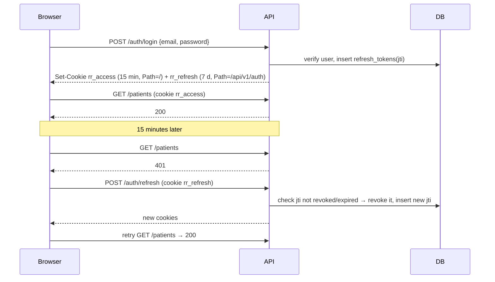

# 15 — HTTP, REST, Authentication & Web Security

> **Where it lives:** API design in `backend/app/api/v1/*.py`; auth in
> `backend/app/core/security.py`, `backend/app/services/auth_service.py`,
> `backend/app/api/v1/auth.py`, `backend/app/api/deps.py`; client side in
> `frontend/src/api/client.ts`, `frontend/src/features/auth/*`, `frontend/src/lib/permissions.ts`.

---

## 1. What & why

**HTTP** — the request/response protocol of the web: a client sends a *method* + *path* + headers +
optional body; the server answers with a *status code* + headers + body. **REST** — an
architectural style for HTTP APIs: resources identified by URLs, manipulated with standard methods,
stateless requests, standard status codes.

**Authentication (AuthN)** — *who are you?* (login, tokens). **Authorization (AuthZ)** — *what may
you do?* (roles/permissions).

**Analogy:** a hospital. Your ID badge (access token) gets you through doors for 15 minutes; the
front desk (refresh endpoint) re-issues badges if you show your longer-lived visitor pass (refresh
token), which they swap for a new one each time and record in a ledger, so a copied pass is
detected.

---

## 2. Fundamentals: HTTP and REST

### 2.1 Methods

| Method | Meaning | Safe? | Idempotent? | 📍 Example |
|---|---|---|---|---|
| GET | read | ✅ | ✅ | `GET /api/v1/patients` |
| POST | create / action | ❌ | ❌ | `POST /prescriptions/scan`, `/auth/login` |
| PUT | replace whole resource | ❌ | ✅ | `PUT /prescriptions/{id}` (full reviewed record) |
| PATCH | partial update | ❌ | not necessarily | `PATCH /patients/{id}`, `/users/{id}` |
| DELETE | remove | ❌ | ✅ | `DELETE /prescriptions/{id}` |

**Safe** — doesn't change server state. **Idempotent** — repeating it has the same effect as doing
it once (important for retries).

📍 Actions that aren't CRUD are modelled as sub-resources with POST: `/users/{id}/deactivate`,
`/users/{id}/reset-password` (`api/v1/users.py:48-61`), `/prescriptions/{id}/extract`
(`prescriptions.py:71`). That's pragmatic REST.

### 2.2 The API surface

| Method & path | Who | Purpose |
|---|---|---|
| POST `/api/v1/auth/login` | public | set cookies, return user |
| POST `/auth/refresh` | refresh cookie | rotate tokens |
| POST `/auth/logout` | any | revoke refresh token, clear cookies |
| GET `/auth/me` | signed in | current user |
| POST `/auth/change-password` | signed in | change password, sign out everywhere |
| GET/POST `/users`, GET/PATCH `/users/{id}`, POST `…/deactivate`, `…/activate`, `…/reset-password` | admin | staff management |
| GET `/patients`, GET/PATCH `/patients/{id}` | signed in | patients |
| DELETE `/patients/{id}` | admin | delete patient + prescriptions + photos |
| POST `/prescriptions/scan` | any staff | upload pages → draft (201) |
| GET `/prescriptions`, GET `/prescriptions/{id}` | signed in | list/detail |
| GET `/prescriptions/{id}/pages/{n}` | signed in | photo page (JPEG) |
| POST `/prescriptions/{id}/extract` | any staff | re-read draft |
| GET `/prescriptions/{id}/pdf` | signed in | typed PDF (filed only) |
| PUT `/prescriptions/{id}` | admin/dentist | file or correct |
| DELETE `/prescriptions/{id}` | staff (drafts) / admin (filed) | delete |
| GET `/health` | public | liveness |

### 2.3 Status codes used

| Code | Meaning | 📍 |
|---|---|---|
| 200 OK | success with body | most |
| 201 Created | resource created | `prescriptions.py:18`, `users.py:33` |
| 204 No Content | success, no body | `patients.py:48`, `prescriptions.py:107` |
| 400 Bad Request | domain rule broken | `BadRequest` e.g. `too_many_pages`, `still_reading`, `last_admin` |
| 401 Unauthorized | not authenticated / session expired | `Unauthorized` (`core/errors.py:39-41`) |
| 403 Forbidden | authenticated but not allowed | `Forbidden` (`:44-46`) |
| 404 Not Found | missing resource | `NotFound` |
| 409 Conflict | uniqueness clash | `email_taken`, `patient_code_taken` |
| 413, 429 | mapped in `_HTTP_CODES` | `core/errors.py:58-67` |
| 422 Unprocessable Entity | validation failed | `core/errors.py:77-91` |
| 500 | unexpected | generic message (`:102-107`) |

**401 vs 403** — 401 means "I don't know who you are (log in)"; 403 means "I know who you are and
the answer is no".

### 2.4 Error envelope and pagination

`{"error": {"code": "patient_code_taken", "message": "Another patient already has the ID RR-1042",
"details": null}}` — machine-readable `code` for the UI, human `message` for display
(`README.md:117`). Lists: `?page=&page_size=` → `{items, total, page, page_size}` (`README.md:118`).

### 2.5 Headers that matter here

| Header | 📍 | Why |
|---|---|---|
| `Set-Cookie` | `api/v1/auth.py:18-37` | issue tokens |
| `Content-Type: multipart/form-data; boundary=…` | set by browser for FormData | uploads |
| `Content-Disposition: attachment; filename="…"` | `prescriptions.py:92` | download name |
| `Cache-Control: private, max-age=86400` | `prescriptions.py:68` | photos cached in the user's browser only, not shared caches |
| `Cache-Control: private, no-store` | `prescriptions.py:93` | medical PDF never stored |

---

## 3. Intermediate: authentication design

### 3.1 Password hashing with Argon2

📍 `backend/app/core/security.py:12-25`:

```python
_hasher = PasswordHasher()                     # argon2id with library defaults
def hash_password(password: str) -> str:
    return _hasher.hash(password)              # "$argon2id$v=19$m=65536,t=3,p=4$<salt>$<hash>"
def verify_password(password: str, password_hash: str) -> bool:
    try:
        return _hasher.verify(password_hash, password)
    except (VerificationError, InvalidHashError):
        return False
```

- **Hash** — one-way function; you can check a password but not recover it.
- **Salt** — random bytes stored with each hash so identical passwords produce different hashes and
  rainbow tables are useless (Argon2 adds it automatically).
- **Argon2id** — winner of the Password Hashing Competition; **memory-hard** (64 MiB per hash by
  default), making GPU/ASIC cracking expensive. Alternatives: bcrypt (fine, 72-byte limit), scrypt,
  PBKDF2 (FIPS). Never MD5/SHA-256 alone (too fast).

📍 **Timing-attack defence**, `services/auth_service.py:19-21, 43-49`:

```python
_DUMMY_HASH = hash_password("not-a-real-password")
…
user = db.scalar(select(User).where(User.email == email.lower()))
if user is None:
    verify_password(password, _DUMMY_HASH)     # spend the same ~time as a real check
    raise Unauthorized("Incorrect email or password")
if not verify_password(password, user.password_hash):
    raise Unauthorized("Incorrect email or password")   # same message → no user enumeration
```

**User enumeration** — learning which emails have accounts from different messages or response
times. Tested: `tests/test_auth.py:29-36`.

### 3.2 JWTs

**JWT (JSON Web Token)** — `base64url(header).base64url(payload).base64url(signature)`. The
signature (here **HS256** = HMAC-SHA256 with a shared secret) proves the server issued it and nobody
changed it. **The payload is readable by anyone** — never put secrets in it.

📍 `core/security.py:28-53`:

```python
def create_access_token(user_id, role):
    expires = utcnow() + timedelta(minutes=get_settings().access_token_minutes)       # 15 min
    token = _encode({"sub": str(user_id), "role": role, "type": "access", "exp": expires})
    return token, expires

def create_refresh_token(user_id, jti):
    expires = utcnow() + timedelta(days=get_settings().refresh_token_days)            # 7 days
    token = _encode({"sub": str(user_id), "jti": str(jti), "type": "refresh", "exp": expires})
    return token, expires

def decode_token(token, expected_type):
    try:
        payload = jwt.decode(token, s.jwt_secret, algorithms=[s.jwt_algorithm])   # verifies signature + exp
    except jwt.PyJWTError:
        return None
    if payload.get("type") != expected_type:      # a refresh token can't be used as an access token
        return None
    return payload
```

| Claim | Meaning |
|---|---|
| `sub` | subject = user id |
| `exp` | expiry (PyJWT rejects expired tokens) |
| `jti` | JWT id — here the primary key of the `refresh_tokens` row |
| `type` | custom: `access` vs `refresh` — prevents **token confusion** |
| `role` | informational; the server re-reads the user from the DB anyway |

`algorithms=[...]` is passed explicitly — prevents the classic **`alg: none`/algorithm-confusion**
attack.

### 3.3 Access + refresh token pattern



**Why two tokens?** Short-lived access tokens limit damage if stolen and need no DB lookup to
verify (though this app looks the user up anyway for `is_active`). Long-lived refresh tokens are
stored server-side, so they can be **revoked**.

### 3.4 Refresh token rotation and reuse detection

📍 `services/auth_service.py:66-93`:

```python
def rotate_refresh_token(db, raw_token):
    payload = decode_token(raw_token, "refresh") if raw_token else None
    if payload is None:
        raise Unauthorized("Session expired. Please sign in again.")
    stored = db.get(RefreshToken, uuid.UUID(payload["jti"]))
    if stored is None:
        raise Unauthorized(...)
    if stored.revoked_at is not None:
        # Two tabs refreshing at the same moment is normal; outside that grace
        # window, a replayed revoked token may have been stolen, so end every
        # session for this user.
        if utcnow() - stored.revoked_at > REUSE_GRACE:          # 30 s
            revoke_all_for_user(db, stored.user_id)
            db.commit()
        raise Unauthorized(...)
    user = stored.user
    if not user.is_active or stored.expires_at <= utcnow():
        raise Unauthorized(...)
    tokens = _issue_tokens(db, user)
    stored.revoked_at = utcnow()
    stored.replaced_by_id = tokens.refresh_jti                   # audit chain
    db.commit()
    return user, tokens
```

- **Rotation** — every refresh invalidates the old token and issues a new one.
- **Reuse detection** — if an *already rotated* token shows up again, either an attacker or the
  legitimate user is using a stale copy; revoking *all* the user's tokens forces re-login and kicks
  the attacker out. This follows the OAuth 2.0 Security BCP recommendation.
- **Grace window** — two tabs refreshing concurrently would otherwise look like theft. The frontend
  also de-duplicates refreshes within one tab (`frontend/src/api/client.ts:101-111`).

### 3.5 Cookies

📍 `api/v1/auth.py:14-37` — both cookies are:

| Attribute | Value | Protects against |
|---|---|---|
| `HttpOnly` | ✅ | JS (XSS) can't read tokens |
| `Secure` | `COOKIE_SECURE` (false in dev, **must be true over HTTPS**) | sending over plain HTTP |
| `SameSite=Lax` | ✅ | cookies not sent on cross-site POST/fetch → CSRF protection |
| `Path` | access `/`, refresh `/api/v1/auth` | refresh token only travels to auth endpoints |
| `Expires` | token expiry | browser drops it automatically |

**Cookies vs `localStorage` + `Authorization: Bearer`**: localStorage is readable by any injected
script; httpOnly cookies are not. Cookies need CSRF thinking; bearer tokens don't. For a browser-only
SPA on the same site, httpOnly SameSite cookies are the stronger default.

### 3.6 Revocation paths

| Event | Effect | 📍 |
|---|---|---|
| Logout | revoke this refresh token, clear cookies | `auth_service.py:96-103`, `auth.py:63-71` |
| Change password | revoke all refresh tokens, clear cookies | `auth_service.py:106-111` |
| Admin resets password | revoke all | `user_service.py:104-107` |
| Deactivate user | revoke all + `is_active` checked on **every** request | `user_service.py:93-101`, `deps.py:29-31` |

⚠️ An already-issued **access token** stays valid until it expires (≤ 15 min) after a password
change on *other* devices — unless the user is deactivated (checked per request). Acceptable
trade-off, but a `token_version` / `password_changed_at` check in `get_current_user` would close it.

---

## 4. Advanced: authorization and attacks

### 4.1 RBAC

**RBAC (Role-Based Access Control)** — permissions attach to roles; users have one role.

| Action | Admin | Dentist | Receptionist | 📍 backend |
|---|---|---|---|---|
| Manage staff | ✅ | | | `AdminUser` (`users.py`) |
| Scan / re-read / discard draft | ✅ | ✅ | ✅ | `ScanUser` |
| File / correct prescription | ✅ | ✅ | | `ClinicalUser` (`prescriptions.py:100`) |
| Delete filed prescription | ✅ | | | role check in `prescription_service.delete` (`:338-339`) |
| Delete patient | ✅ | | | `AdminUser` (`patients.py:49`) |
| View/edit patients | ✅ | ✅ | ✅ | `CurrentUser` |

Frontend mirror: `frontend/src/lib/permissions.ts:7-26` — *hides* UI only ("This only hides
controls; the backend enforces every rule independently", `:1-4`). Business rules beyond roles live
in services: "keep at least one active admin" (`user_service.py:68-75`), "can't deactivate yourself"
(`:95-96`).

**IDOR (Insecure Direct Object Reference)** — accessing another user's resource by changing an id.
Single-clinic app: all staff may see all patients, so no per-row ownership checks are needed. A
multi-clinic version would need `clinic_id` scoping on every query.

### 4.2 CSRF

**CSRF (Cross-Site Request Forgery)** — a malicious site makes the victim's browser send an
authenticated request (cookies attach automatically). Defences: SameSite cookies, CSRF tokens
(double-submit), checking `Origin`/`Referer`, requiring a custom header or JSON content type.

Here: `SameSite=Lax` blocks cookies on cross-site POST/PUT/DELETE and on cross-site `fetch`. The
remaining gap would be state-changing **GET** endpoints — there are none (all mutations are
POST/PUT/PATCH/DELETE). ⚠️ "Same-site" ≠ "same-origin": a compromised sibling subdomain counts as
same-site; for higher assurance add an `Origin` check or CSRF token.

### 4.3 CORS

**CORS (Cross-Origin Resource Sharing)** — the browser blocks JS from reading cross-origin responses
unless the server sends `Access-Control-Allow-Origin`; "non-simple" requests (JSON, custom
headers, PUT/DELETE) first send an `OPTIONS` **preflight**. CORS is a *relaxation* of the
same-origin policy, not a protection for the server. 📍 Not needed in the standard setup thanks to
the Vite proxy; enabled with explicit origins + credentials only if configured
(`backend/app/main.py:22-29`).

### 4.4 Upload security

📍 `services/prescription_service.py:56-68, 185-216`:
- Page count (1–6) and per-file size limits.
- **Re-encode every image** with Pillow (decode → EXIF transpose → RGB → resize → JPEG): strips
  embedded scripts/polyglots and metadata (including GPS EXIF!).
- `Image.DecompressionBombError` caught — a tiny PNG claiming 100k×100k pixels can't exhaust memory.
- Server-chosen filenames `prescriptions/{uuid}-{n}.jpg` — no path traversal from user filenames.
- Files served only through an authenticated endpoint (`prescriptions.py:60-68`), not a public
  static folder.

### 4.5 OWASP Top 10 (2021) mapped to this project

| Risk | Status here |
|---|---|
| A01 Broken Access Control | role dependencies on every route ✅; ⚠️ scan route/UI permission mismatch (UX only) |
| A02 Cryptographic Failures | Argon2, signed JWT ✅; ⚠️ `COOKIE_SECURE=false` default — must enable over HTTPS |
| A03 Injection | parameterised SQL ✅; LLM prompt injection limited to draft fields reviewed by a dentist |
| A04 Insecure Design | human-in-the-loop review ✅ |
| A05 Security Misconfiguration | ⚠️ dev Dockerfiles, default DB password, `--reload` |
| A06 Vulnerable Components | ranges in requirements, no lock/audit ⚠️ |
| A07 Identification & Auth Failures | rotation, reuse detection, timing-safe login ✅; ⚠️ no rate limit / lockout |
| A08 Software & Data Integrity | — |
| A09 Logging & Monitoring | errors logged; ⚠️ no audit log of who viewed/changed records |
| A10 SSRF | no user-supplied URLs fetched ✅ |

### 4.6 Secrets and privacy

- `JWT_SECRET` must be long and random (`.env.example:7-8` shows how); app refuses to start in
  production with the dev secret (`core/config.py:51-55`).
- ⚠️ Bootstrap admin password `Admin@12345` is documented (`README.md:37`); nothing forces a change.
  Better: generate a random one on first run and print it, or require `BOOTSTRAP_ADMIN_PASSWORD`.
- ⚠️ **Health data privacy:** photos go to Google Gemini; the README warns the free tier may use data
  to improve products (`README.md:43`). Use a paid tier with data-processing terms before real
  patients; consider data-protection law obligations.
- ⚠️ `extraction_service.py:198` logs up to 200 characters of invalid model output — could contain
  patient data in logs.

---

## 5. Under the hood

- **TLS/HTTPS** — encrypts HTTP; certificate proves the server's identity. `Secure` cookies require
  it. Terminated typically at a reverse proxy (nginx/Caddy/Traefik).
- **HTTP/1.1 vs HTTP/2** — HTTP/2 multiplexes many requests over one connection (Uvicorn speaks
  HTTP/1.1; a proxy can offer HTTP/2 to browsers).
- HMAC-SHA256 signature = `HMAC(secret, header.payload)`; verification recomputes and compares in
  constant time.

---

## 6. Comparisons

| X vs Y | Answer |
|---|---|
| Session cookie (server session id) vs JWT | revocable, server state vs stateless, self-contained; this app is a hybrid (JWT access + DB-tracked refresh) |
| HS256 vs RS256 | shared secret vs private/public keys (others can verify without signing ability) |
| OAuth2 vs OIDC | delegated authorization vs identity layer on OAuth2 (ID tokens) |
| bcrypt vs Argon2 | CPU-hard vs memory-hard |
| SameSite Lax vs Strict vs None | blocks cross-site subrequests but allows top-level GET navigation vs blocks all cross-site vs sends everywhere (needs Secure) |
| CORS vs CSRF | browser read permission vs forged writes |
| PUT vs PATCH | replace vs partial |
| REST vs GraphQL vs gRPC | resources + HTTP semantics vs one endpoint, client-shaped queries vs binary RPC with schemas |
| 401 vs 403 | unauthenticated vs unauthorized |

---

## 7. Patterns & anti-patterns

- ✅ Tokens in httpOnly cookies; refresh cookie path-scoped.
- ✅ Backend is the source of truth for permissions.
- ✅ Consistent error codes.
- ❌ Storing JWTs in localStorage; long-lived access tokens; JWTs without expiry; trusting `role` in
  the token without DB checks for sensitive actions.

---

## 8. Cheat sheet

```
Login → Set-Cookie: rr_access=…; HttpOnly; SameSite=Lax; Path=/
        Set-Cookie: rr_refresh=…; HttpOnly; SameSite=Lax; Path=/api/v1/auth
401 → POST /auth/refresh (single flight) → retry once → else go to /login
JWT: header.payload.signature  (payload is NOT encrypted)
argon2: hash(pw) / verify(hash, pw) — constant message + dummy verify for unknown emails
Status: 200 201 204 | 400 401 403 404 409 422 | 500
```

---

## 9. Why this design + alternatives

A browser-only staff app on one site: cookie-based JWTs avoid XSS token theft, rotation gives
revocation, and FastAPI dependencies make RBAC explicit. Alternatives: classic server-side sessions
(simpler revocation, a sessions table or Redis), or an identity provider (Auth0, Keycloak, Google
Workspace SSO) — attractive for MFA and password resets, overkill for one clinic today.
