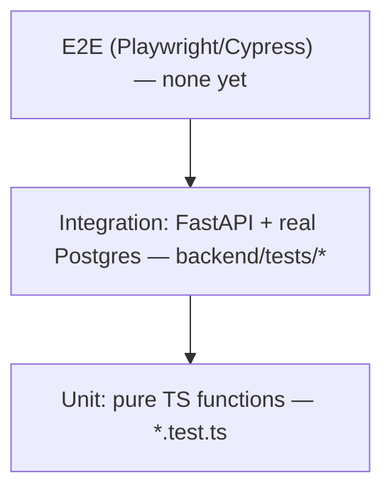

# 16 — Testing: pytest (backend) & Vitest (frontend)

> **Where it lives:** `backend/tests/conftest.py`, `test_auth.py`, `test_users.py`,
> `test_prescriptions.py`; `backend/pyproject.toml:1-6`; `frontend/src/lib/format.test.ts`,
> `frontend/src/features/prescriptions/form.test.ts`; `frontend/vite.config.ts:42-45`.

---

## 1. What & why

**Automated tests** — code that runs your code and checks results, so you can change things without
fear. **pytest** — Python's de-facto test framework (plain `assert`, fixtures, parametrisation,
plugins). **Vitest** — a Vite-native, Jest-compatible test runner for JS/TS.

**Test pyramid** — many fast **unit** tests (one function), fewer **integration** tests (several
parts + real DB), few slow **end-to-end (E2E)** tests (real browser).



**Analogy:** unit tests check each brick; integration tests check the wall; E2E tests walk through
the house.

---

## 2. Fundamentals — pytest

### 2.1 Discovery and config

Files `test_*.py`, functions `test_*`. 📍 `backend/pyproject.toml:1-6` sets `testpaths = ["tests"]`
and silences one known deprecation warning. Run: `docker compose exec backend pytest`
(`README.md:78`).

### 2.2 Plain `assert`

📍 `tests/test_auth.py:13-18`:

```python
assert res.status_code == 200
assert res.json()["role"] == "dentist"
assert "password_hash" not in res.json()          # response_model filtered it out
set_cookie = res.headers.get_list("set-cookie")
assert any(c.startswith("rr_access=") and "HttpOnly" in c for c in set_cookie)
assert any(c.startswith("rr_refresh=") and "Path=/api/v1/auth" in c for c in set_cookie)
```

pytest rewrites `assert` to show both sides on failure. `assert res.status_code == 201, res.text`
(`test_prescriptions.py:91`) adds the response body to the failure message.

### 2.3 Fixtures

**Fixture** — a function that provides a test dependency (a DB session, a client, a fake); tests
request it by **parameter name**. Scope: `function` (default), `module`, `session`. `yield`
fixtures run teardown after the test.

📍 `tests/conftest.py`:

| Fixture | Scope | Provides |
|---|---|---|
| `engine` (`:35-47`) | session | ensures the test DB exists, `DROP SCHEMA public CASCADE`, runs Alembic to head |
| `db` (`:50-60`) | function | Session inside a transaction that is **rolled back** after each test |
| `client` (`:63-68`) | function | `TestClient` with `get_db` overridden to use `db` |
| `make_user` (`:74-91`) | function | factory creating users with unique emails |
| `as_role` (`:99-110`) | function | factory: create a user of a role and log the client in |

Fixtures depend on fixtures: `as_role → client, make_user → db → engine`.

**Factory fixture** — a fixture that returns a function, so a test can create many objects with
custom arguments: `make_user(UserRole.ADMIN)`, `make_user(is_active=False)` (`test_auth.py:40`).

### 2.4 Parametrisation

📍 `tests/test_users.py:20-26`:

```python
@pytest.mark.parametrize("role", [UserRole.DENTIST, UserRole.RECEPTIONIST])
def test_non_admins_cannot_manage_staff(as_role, role):
    client, _ = as_role(role)
    assert client.get("/api/v1/users").status_code == 403
```

One test body, two cases. 📍 Tuples of inputs + expected messages:
`test_prescriptions.py:291-305`.

---

## 3. Intermediate

### 3.1 Test isolation with real Postgres

Why not SQLite or mocks? The app uses Postgres-only features (`pg_trgm.similarity`, JSONB, enums,
`FILTER`, sequences). Testing against the real engine catches real bugs. Isolation comes from the
**transaction-per-test + savepoint** trick (module 14 §3.6): each test sees a clean DB and is fast
(no re-migration).

⚠️ The session fixture runs `DROP SCHEMA public CASCADE` (`conftest.py:41`) on
`TEST_DATABASE_URL`. If someone points that variable at the real database, tests wipe it. A guard
(`assert url.endswith("_test")`) would make this impossible.

### 3.2 Dependency overrides

📍 `conftest.py:65` `app.dependency_overrides[get_db] = lambda: db` and `.clear()` after
(`:68`) — FastAPI's built-in seam for testing.

### 3.3 Monkeypatching

**Monkeypatch** — temporarily replacing an attribute (function, module variable) during a test;
pytest restores it afterwards.

📍 `tests/test_prescriptions.py:52-78`:

```python
@pytest.fixture(autouse=True)                       # applies to every test in this module
def storage(tmp_path, monkeypatch):
    monkeypatch.setattr(prescription_service, "_storage_root", lambda: tmp_path)   # photos into a temp dir
    return tmp_path

@pytest.fixture(autouse=True)
def background_session(db, monkeypatch):
    """Background reads use the test's transaction instead of a new session."""
    monkeypatch.setattr(prescription_service, "new_session", lambda: contextlib.nullcontext(db))

@pytest.fixture
def extraction(monkeypatch):
    """Stub the Gemini call. Set state["error"] to simulate a failed read."""
    state = {"result": EXTRACTED, "error": None, "calls": 0}
    def fake_extract(images, media_type="image/jpeg", today=None):
        state["calls"] += 1
        state["pages"] = len(images)
        assert all(i[:2] == b"\xff\xd8" for i in images), "photos are re-encoded as JPEG before reading"
        if state["error"]:
            raise extraction_service.ExtractionError(state["error"])
        return state["result"]
    monkeypatch.setattr(extraction_service, "extract", fake_extract)
    return state
```

- `tmp_path` — built-in fixture: a unique temporary directory per test.
- **Fake vs mock vs stub:** a *stub* returns canned data; a *fake* is a working lightweight
  implementation; a *mock* also records/asserts calls. `fake_extract` is a stub that records calls
  (`state["calls"]`) and asserts an invariant (JPEG magic bytes `FF D8`).
- Never call real external APIs (Gemini) in unit/integration tests: slow, flaky, costs money,
  non-deterministic.
- `prescription_service` calls `extraction_service.extract(...)` through the **module attribute**
  (`prescription_service.py:161`), which is why patching `extraction_service.extract` works. Had it
  used `from ...extraction_service import extract`, the patch would miss.

**Background tasks in tests:** `TestClient` runs `BackgroundTasks` synchronously after the response,
so by the time `_scanned()` GETs the draft (`test_prescriptions.py:88-93`), the fake read finished.

### 3.4 What the backend tests cover

| Area | Tests |
|---|---|
| Auth cookies, case-insensitive email, consistent errors, inactive users | `test_auth.py:9-43` |
| `/me`, refresh rotation, logout revocation, deactivation, change password | `test_auth.py:45-115` |
| Staff RBAC, normalisation, duplicates, validation, pagination, last admin, self-deactivate, 404 | `test_users.py` |
| Scan RBAC, discard rules, multi-page, limits, cleanup of blank AI fields, failed read, invalid image | `test_prescriptions.py:116-218` |
| Filing under new/existing patient, matches, duplicate codes, generated codes, validation | `:221-305` |
| Delete rules, interrupted read, still-reading guard, PDF download, patient deletion | `:308-376` |

---

## 4. Vitest (frontend)

📍 `frontend/vite.config.ts:42-45`: `test: { environment: 'node', include: ['src/**/*.test.ts'] }` —
pure functions only, so no DOM (`jsdom`) is needed.

📍 `frontend/src/lib/format.test.ts:6-17, 33-41`:

```ts
describe('formatBDT', () => {
  it('formats whole taka with thousands separators', () => {
    expect(formatBDT(150_000)).toBe('৳ 1,500')
    expect(formatBDT(12_345_600)).toBe('৳ 1,23,456')        // lakh grouping
  })
})

it.each(['01712345678', '+8801712345678', '8801712345678', '01712-345678'])('accepts %s', (input) => {
  expect(normalizeBDPhone(input)).toBe('+8801712345678')
})
```

| Matcher | Checks |
|---|---|
| `toBe` | `Object.is` (primitives, same reference) |
| `toEqual` | deep equality |
| `toMatchObject` | subset of properties (`form.test.ts:45`) |
| `toBeUndefined`, `toBeNull` | — |
| `toThrow` | function throws |

📍 Time-zone test, `format.test.ts:20-30`: `'2026-09-25T20:30:00Z'` must format as `26/09/2026` and
`2:30 AM` — proves Asia/Dhaka is applied regardless of the machine's zone.

📍 `form.test.ts` tests the review form logic (pre-fill, strong-match pre-selection, conversion to
payload, Zod cross-field rule, uncertain-path matching) **without rendering React** — the payoff of
keeping logic in pure functions (`features/prescriptions/form.ts`).

---

## 5. Advanced

- **Coverage** (`pytest --cov`, `vitest --coverage`) — a metric, not a goal; test behaviours.
- **Component tests** — React Testing Library + `jsdom` (`render`, `screen.getByRole`,
  `userEvent`). ⚠️ None exist; the review page's permission logic (`PrescriptionReviewPage.tsx:101-105`)
  and the scan-route bug would be caught by component tests.
- **E2E** — Playwright: real browser against Docker Compose. ⚠️ None.
- **Contract tests** — check the frontend's `api/types.ts` matches `/openapi.json`.
- **Property-based testing** — Hypothesis (Python) / fast-check (TS) generate many inputs (great for
  `normalize_bd_phone`).
- **CI** — GitHub Actions running `pytest`, `npm run typecheck`, `eslint`, `npm test` on each PR.
  ⚠️ No CI config in the repo.
- **Flaky tests** — time-dependent tests: `test_interrupted_read_can_be_retried`
  (`test_prescriptions.py:321-333`) avoids sleeping by *moving the timestamp back* instead.

---

## 6. Comparisons

| X vs Y | Answer |
|---|---|
| pytest vs unittest | fixtures + plain assert vs xUnit classes + `self.assertEqual` |
| Vitest vs Jest | Vite-native, ESM, fast vs older, Babel-based; same API |
| fixture vs setUp | composable, scoped, injected vs per-class method |
| mock vs fake vs stub | §3.3 |
| real DB vs SQLite vs mocks | fidelity vs speed vs isolation |
| unit vs integration vs E2E | pyramid |
| `toBe` vs `toEqual` | identity vs deep equality |
| TestClient vs live server | in-process ASGI vs real network |

---

## 7. Patterns & anti-patterns

- ✅ Tests read like specifications (`test_assistant_scans_but_only_a_dentist_files`).
- ✅ Helpers (`_scan`, `_scanned`, `_save_body(**overrides)`) keep tests short.
- ✅ Assert on error **codes**, not messages, where possible (`["error"]["code"] == "too_many_pages"`).
- ❌ Tests depending on each other or on order; sleeping; hitting real APIs.

---

## 8. Cheat sheet

```python
@pytest.fixture(scope="session") def engine(): …; yield eng; eng.dispose()
@pytest.fixture(autouse=True) def x(monkeypatch, tmp_path): monkeypatch.setattr(mod, "fn", fake)
@pytest.mark.parametrize(("a", "b"), [(1, 2), (3, 4)])
app.dependency_overrides[get_db] = lambda: db
with TestClient(app) as c: c.post(url, json=…, files=[("files", (name, bytes, mime))])
pytest -k refresh -x -vv
```

```ts
describe('x', () => { it('does y', () => { expect(f()).toBe(1) }) })
it.each([a, b])('case %s', (v) => …)
expect(obj).toEqual({...}); expect(obj).toMatchObject({...})
npx vitest run / npx vitest (watch)
```

---

## 9. Why chosen

pytest + real Postgres gives high-confidence integration tests for an API whose correctness depends
on SQL features. Vitest matches the Vite toolchain with zero config.
