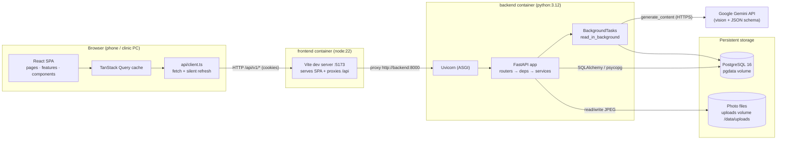
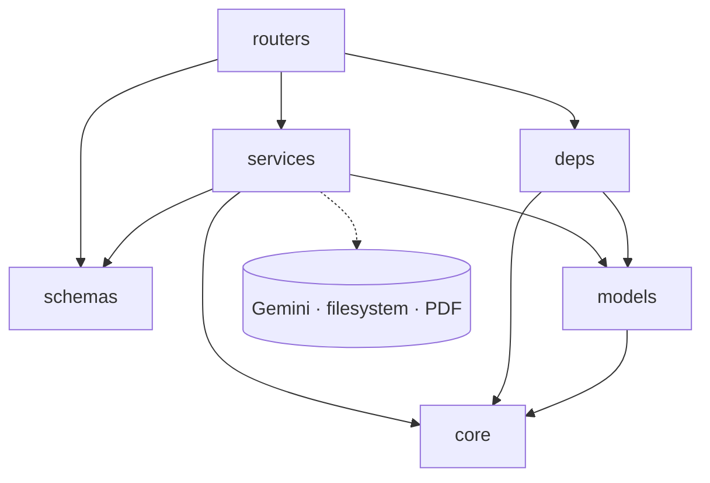
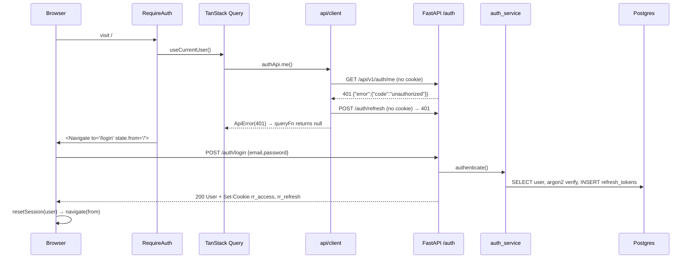
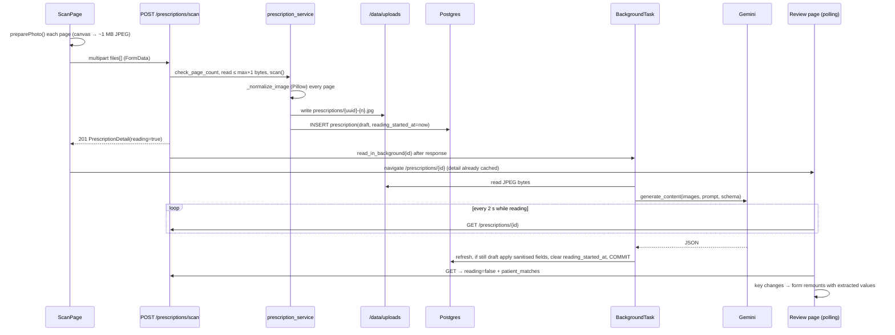

# 02 — Architecture

## 1. System diagram

All browser traffic goes to **one origin** (`localhost:5173`); Vite forwards `/api` to the backend
(`frontend/vite.config.ts:17-22`), so cookies are first-party and no CORS is needed
(`docker-compose.yml:44`).

## 2. Layers and responsibilities

### Backend (`README.md:93-102`)

| Layer | Folder | Responsibility | Must not |
|---|---|---|---|
| Entry | `app/main.py` | build app, middleware, handlers, routers | contain logic |
| Routers | `app/api/v1/*.py` | HTTP shape: params, status codes, cookies, response models | touch the ORM directly |
| Dependencies | `app/api/deps.py` | DB session, current user, role checks | — |
| Schemas | `app/schemas/*.py` | validate input, shape output | query the DB |
| Services | `app/services/*.py` | business rules, transactions, files, AI, PDFs | know about HTTP (except raising `AppError`s) |
| Models | `app/models/*.py` | table mapping, relationships | business logic |
| Core | `app/core/*.py` | config, DB engine, errors, security, time, validators | depend on services |
| Migrations | `alembic/` | schema history | — |

### Frontend (`README.md:103-111`)

| Layer | Folder | Responsibility |
|---|---|---|
| Entry | `main.tsx`, `App.tsx` | mount, QueryClient, routes, session-expired handler |
| API | `api/` | fetch wrapper, typed endpoint functions, TS types of payloads |
| Features | `features/<domain>/` | TanStack Query hooks, form schemas/converters, feature components |
| Pages | `pages/` | route-level screens composing features + components |
| Components | `components/ui` (shadcn), `layout`, `common` | presentation |
| Lib | `lib/` | pure helpers: formatting, phone, image, permissions, `cn` |
| i18n | `i18n/` | all strings (`t`) |

## 3. End-to-end request traces

### Trace 1 — Opening the app and signing in

Hop by hop:
1. `frontend/src/main.tsx:7-11` mounts `<App/>`; `App.tsx:34-86` builds the router; `/` is inside
   `RequireAuth` (`App.tsx:37`).
2. `features/auth/guards.tsx:15` calls `useCurrentUser()` → `features/auth/hooks.ts:20-34` →
   `api/auth.ts:17` `api.get<User>('/auth/me')` → `api/client.ts:132-136` `request` →
   `sendAuthed` (`:116-130`) → `send` (`:60-79`) → `fetch('/api/v1/auth/me', {credentials:'include'})`.
3. Vite proxies to the backend (`vite.config.ts:17-22`). FastAPI matches `api/v1/auth.py:74-76`
   (`me`), whose `CurrentUser` dependency runs `api/deps.py:21-32`: no `rr_access` cookie →
   `Unauthorized()` → handler `core/errors.py:71-75` returns 401 JSON.
4. `sendAuthed` sees 401 (path not in `NO_REFRESH_PATHS`, `client.ts:113`) → `refreshSession()`
   (`:103-111`) → POST `/auth/refresh` → `auth.py:52-60` → `auth_service.rotate_refresh_token`
   (`services/auth_service.py:66-70`) → no cookie → 401. `onSessionExpired()` runs
   (`client.ts:123-125`) — the handler in `App.tsx:89-95` sees no previous user, so no toast.
5. `toError` (`client.ts:81-98`) throws `ApiError(401)`; `useCurrentUser`'s `queryFn` converts it to
   `null` (`hooks.ts:27`). `RequireAuth` renders `<Navigate to="/login" replace state={{ from: location }}/>`
   (`guards.tsx:31`).
6. `pages/LoginPage.tsx:41-43` submits → `useLogin` (`hooks.ts:43-49`) → `api/auth.ts:15` POST
   `/auth/login` → `auth.py:45-49` validates `LoginRequest` (`schemas/user.py:50-52`) →
   `auth_service.authenticate` (`auth_service.py:43-55`): `SELECT … WHERE email = lower(email)`,
   Argon2 verify (`core/security.py:21-25`), set `last_login_at`, `_issue_tokens` (`:35-40`) inserts
   a `RefreshToken` row and signs both JWTs (`core/security.py:33-42`), `commit`.
7. `_set_auth_cookies` (`auth.py:18-37`) adds two `Set-Cookie` headers; response body is the user via
   `response_model=UserOut` (no password hash).
8. `onSuccess: resetSession(qc, user)` (`hooks.ts:47`, `:14-17`) removes old cached data and sets
   `ME_KEY`; `LoginPage.tsx:42` navigates back to `from`.

### Trace 2 — Scanning a prescription (upload → background AI read → live review page)

Hop by hop:
1. `pages/ScanPage.tsx:44-51` collects up to 6 `File`s (camera input `:200-211`, gallery `:212-223`),
   with object-URL previews.
2. `read()` (`ScanPage.tsx:61-71`) runs `preparePhoto` on all pages in parallel (`lib/image.ts:9-25`),
   then `scan.mutate(photos)` → `features/prescriptions/hooks.ts:47-53` → `api/prescriptions.ts:19-23`
   builds `FormData` with repeated `files` → `client.ts` POST (no JSON header for forms, `:61, 66`).
3. Backend: `api/v1/prescriptions.py:18-33`. `ScanUser` dependency (`deps.py:51-53`) authorises any
   staff role. `check_page_count` (`prescription_service.py:178-182`); each file read up to
   `max_upload_mb*1MiB + 1` bytes (`prescriptions.py:29-30`).
4. `prescription_service.scan` (`:185-216`): size check → `_normalize_image` for **all** pages before
   writing anything (`:195`, `:56-68`) → generate UUID → write files under `STORAGE_DIR`
   (`:197-202`) → insert `Prescription(status=DRAFT, image_paths, reading_started_at=utcnow())`
   (`:204-215`) → `commit`.
5. `background.add_task(read_in_background, prescription.id)` (`prescriptions.py:32`) and the endpoint
   returns `to_detail` (`prescription_service.py:273-304`) with `reading=True`, image URLs
   `/api/v1/prescriptions/{id}/pages/{n}`, and **no** patient matches yet (`:276`).
6. Frontend `onSuccess: store` puts the detail in the cache (`hooks.ts:39-45`) and `ScanPage.tsx:66`
   navigates (replace) to `/prescriptions/{id}`.
7. `PrescriptionReviewPage` (`pages/PrescriptionReviewPage.tsx:72-95`) → `usePrescription`
   (`hooks.ts:22-37`) — cache hit, `refetchInterval` 2 s while `reading`. The form is disabled during
   reading (`:235`) and a status banner shows (`:178-190`). Photos load via
   `GET /prescriptions/{id}/pages/{n}` → `prescriptions.py:60-68` → `FileResponse`.
8. Background task (after the response): `read_in_background` (`prescription_service.py:150-175`)
   opens its own session (`new_session`, `:147`), reads files, calls `extraction_service.extract`
   (`extraction_service.py:137-199`) → Gemini. On `ExtractionError`, the message is stored on the draft.
9. `db.refresh(prescription)` (`:167`) — if a dentist filed it meanwhile, stop. Else
   `_apply_extraction` sanitises fields (`:110-120`), clears `reading_started_at`, commits.
10. Next poll: `to_detail` now computes `patient_matches` via `patient_service.find_matches`
    (`patient_service.py:137-180`: same code / same normalised phone / trigram-similar name). In the
    hook's `queryFn`, the `reading true → false` transition invalidates lists (`hooks.ts:29-32`).
    The page's `key` (`PrescriptionReviewPage.tsx:94`) changes → the form remounts with
    `toFormValues(p)` (`features/prescriptions/form.ts:68-94`), pre-selecting a strong match
    (`:59-66`) and showing **Check** badges for `uncertain_fields` (`:131-133`, page `:135-141`).

### Trace 3 — A dentist files the reviewed prescription under a new patient

1. Submit → `form.handleSubmit` validates with `reviewSchema` (`form.ts:18-47`) →
   `toSaveInput(values)` (`:96-125`) → `useSavePrescription` (`features/prescriptions/hooks.ts:63-73`)
   → `api/prescriptions.ts:28-29` `PUT /prescriptions/{id}`.
2. `api/v1/prescriptions.py:98-104`: `ClinicalUser` (`deps.py:55`) — receptionists get 403
   (`tests/test_prescriptions.py:124`). Body validated as `PrescriptionSave`
   (`schemas/prescription.py:77-98`): XOR patient choice, follow-up ≥ visit, list/length limits,
   `BDPhone` normalisation of the new patient's phone.
3. `prescription_service.save` (`:310-334`): `patient_service.create` (`patient_service.py:93-106`) —
   checks code uniqueness (case-insensitive, `:76-83`) or generates `P-00001` from the sequence
   (`:86-90`), `flush` (no commit). Then copies reviewed fields onto the prescription; if still a
   draft and not reading (`:327-329`), sets `CONFIRMED`, `confirmed_by`, `confirmed_at`; one `commit`
   for patient + prescription.
4. Response `PrescriptionDetail`; `onSuccess` stores the detail and invalidates prescription lists +
   **all patient queries** (`hooks.ts:68-71`).
5. `PrescriptionReviewPage.tsx:117-123` shows a toast with a "Scan next" action and navigates to
   `/patients/{id}`; `PatientDetailPage` (`pages/PatientDetailPage.tsx:50-191`) loads the patient
   (`GET /patients/{id}`) and confirmed history (`GET /prescriptions?patient_id=&status=confirmed`,
   `prescriptions.py:36-52` → `list_prescriptions` with `joinedload`, `prescription_service.py:229-249`).
6. Errors: duplicate code → 409 `patient_code_taken` → mapped to the patient-ID field
   (`PrescriptionReviewPage.tsx:125-126`); 422 → toast with field messages (`:128-129`).

### Trace 4 — Silent token refresh after 15 minutes

1. Any request, e.g. `GET /patients?page=1` → `deps.get_current_user` → `decode_token` fails on `exp`
   (`core/security.py:47-50`) → 401.
2. `client.ts:119-121`: single-flight `refreshSession()` — concurrent 401s share one
   `POST /auth/refresh` (`:101-111`). Browser sends `rr_refresh` because its `Path=/api/v1/auth`
   matches (`auth.py:15, 36`).
3. `rotate_refresh_token` (`auth_service.py:66-93`) validates JWT + DB row, revokes it, links
   `replaced_by_id`, issues a new pair; `_set_auth_cookies` sets new cookies.
4. `client.ts:121` retries the original request once → 200. If refresh failed: `onSessionExpired()`
   → `App.tsx:90-94` clears the session cache (`resetSession(qc, null)`) → `RequireAuth` redirects to
   login, toast "Your session has expired" (only if they had been signed in).
5. Theft scenario: a stolen old refresh token replayed > 30 s after rotation → all of the user's
   refresh tokens revoked (`auth_service.py:76-83`).

### Trace 5 — Sharing a filed prescription as PDF

1. `features/prescriptions/SharePrescription.tsx:40-61` → `prescriptionsApi.pdf(id)`
   (`api/prescriptions.ts:32`) → `api.blob` (`client.ts:146`) — goes through `sendAuthed`, so it also
   benefits from silent refresh.
2. `api/v1/prescriptions.py:82-95`: only `CONFIRMED` with a patient (else 400 `not_filed`) →
   `pdf_service.render` (`pdf_service.py:73-156`) draws an A4 page with Noto fonts and HarfBuzz
   shaping for Bangla → `Response(..., media_type="application/pdf", Content-Disposition: attachment,
   Cache-Control: private, no-store)`.
3. Browser wraps the blob in a `File` (`SharePrescription.tsx:44`); on HTTPS phones
   `navigator.share({files})` opens the share sheet (WhatsApp/Messenger/email); otherwise (or on
   share failure) an `<a download>` saves it (`:24-31, 45-55`).

## 4. Where state and data live

| Data | Location | Lifetime |
|---|---|---|
| Users, tokens, patients, prescriptions | Postgres (`pgdata` volume) | permanent |
| Prescription photos | filesystem `STORAGE_DIR` (`uploads` volume), paths in `prescriptions.image_paths` | until deleted |
| Raw AI output | `prescriptions.extracted` JSONB | permanent (audit) |
| "Being read" flag | `prescriptions.reading_started_at` | cleared when read finishes / considered stale after 5 min |
| Auth tokens | httpOnly cookies in the browser; refresh token ids in `refresh_tokens` | 15 min / 7 days |
| Current user + server data cache | TanStack Query in memory | until reload / reset |
| Filters, pagination, tab | URL search params | per URL |
| Dialog open, picked pages, zoom | React `useState` | per component |
| Settings | env vars → `Settings` (`core/config.py`) | per process |

## 5. Configuration, env vars, secrets

| Variable | Default | Used at |
|---|---|---|
| `DATABASE_URL` | `postgresql+psycopg://rootrecord:rootrecord@db:5432/rootrecord` | `core/config.py:15`, `core/db.py:8`, `alembic/env.py:14` |
| `TEST_DATABASE_URL` | `…/rootrecord_test` | `tests/conftest.py:37` |
| `JWT_SECRET` (secret) | dev value, rejected in production | `core/config.py:20, 51-55` |
| `ACCESS_TOKEN_MINUTES`, `REFRESH_TOKEN_DAYS` | 15 / 7 | `core/security.py:34, 40` |
| `COOKIE_SECURE` | false | `api/v1/auth.py:19` |
| `CORS_ORIGINS` | empty → no CORS middleware | `main.py:22` |
| `STORAGE_DIR`, `MAX_UPLOAD_MB` | `/data/uploads`, 15 | `prescription_service.py:41-42`, `prescriptions.py:29` |
| `GEMINI_API_KEY` (secret), `GEMINI_MODEL` | none / `gemini-3.6-flash` | `extraction_service.py:142-158` |
| `CLINIC_NAME/ADDRESS/PHONE` | `Dental Clinic` | `pdf_service.py:76-90` |
| `BOOTSTRAP_ADMIN_*` | `admin@rootrecord.app` / `Admin@12345` | `app/cli.py:10-19` |
| `VITE_PROXY_TARGET`, `VITE_USE_POLLING` | `http://localhost:8000`, false | `vite.config.ts:16-19` |

## 6. What happens when you run…

### `docker compose up --build`
1. Builds `backend` (`python:3.12-slim`, installs requirements + dev requirements) and `frontend`
   (`node:22-alpine`, `npm ci`) images; pulls `postgres:16-alpine`.
2. Starts `db`; healthcheck `pg_isready` every 3 s (`docker-compose.yml:15-19`).
3. When healthy, starts `backend`: `entrypoint.sh` → `alembic upgrade head` (creates extensions,
   enums, tables, sequence, indexes; migrations 0001→0004) → `python -m app.cli bootstrap-admin`
   (creates the admin if no admin exists, `services/user_service.py:110-122`) → `exec uvicorn
   app.main:app --reload` on :8000.
4. Starts `frontend`: `npm run dev` → Vite on :5173 with HMR, polling, `/api` proxy to
   `http://backend:8000`.
5. Open `http://localhost:5173` (app) or `http://localhost:8000/docs` (Swagger).

### `docker compose exec backend pytest`
Creates `rootrecord_test` if missing, drops/recreates its `public` schema, runs migrations to head,
then each test runs in a rolled-back transaction with Gemini stubbed and photos in a temp dir.

### `npm run build` (frontend)
`tsc -b` type-checks app + node projects (no emit), then `vite build` bundles to `dist/` with
`react`, `data`, `ui` vendor chunks and hashed filenames. (No production server is configured yet.)

### `npm test` / `npm run typecheck` / `npx eslint src`
Vitest runs `src/**/*.test.ts` in Node; TypeScript checks; ESLint flat config with strict TS + hooks
rules.

## 7. Known gaps (summary of ⚠️ review notes)

1. Scan route/top-bar button use `clinical:edit` while nav and backend allow receptionists
   (`App.tsx:46`, `AppShell.tsx:48` vs `nav.ts:28`, `deps.py:50-53`).
2. Background reading holds a DB transaction open during the Gemini call; BackgroundTasks are not
   durable.
3. Dev-only Docker images; no production web server, TLS or backups.
4. No rate limiting on login; default admin password; `COOKIE_SECURE` default false.
5. Hard deletes of clinical records; no audit log; `SoftDelete` mixin unused.
6. Check-then-insert uniqueness races surface as 500s; trigram `similarity()` predicate not indexed.
7. Hand-written frontend types (no OpenAPI codegen); duplicated constants (`MAX_PAGES`, filename
   logic, match-reason strings).
8. No error boundary, no component/E2E tests, no CI.
