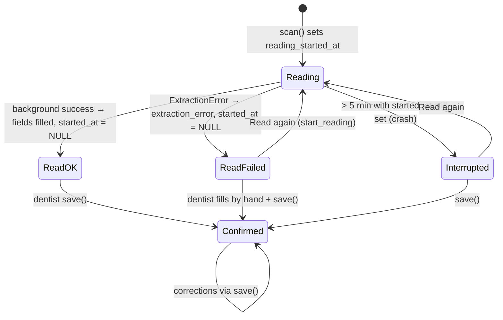

# 14 — `services/prescription_service.py` (344 lines)

**Purpose:** the heart of the app — store scanned pages, read them in the background, expose
summaries/details, file reviewed prescriptions, delete them.
**Called by:** `api/v1/prescriptions.py`, `patient_service.delete` (image paths), tests.
**Calls:** Pillow, `extraction_service`, `patient_service`, `core/db`, settings, time.

## Constants (31-38)

```python
31 # Long edge of the stored photo. Enough to read handwriting; keeps uploads to Gemini small.
32 MAX_IMAGE_EDGE = 2400
33 # Pages per prescription (front and back of a few sheets).
34 MAX_PAGES = 6
35 # Longer than the slowest read (timeouts and retries included). A read still
36 # "running" after this was cut off, e.g. by a server restart.
37 READING_TIMEOUT = timedelta(minutes=5)
38 INTERRUPTED_MESSAGE = "Reading was interrupted. Press Read again or fill it in by hand."
```
Why 5 minutes? Gemini timeout 90 s × 3 attempts (`extraction_service.py:149-151`) ≈ 4.5 min worst case,
so 5 min is "definitely dead". `MAX_PAGES` and `MAX_IMAGE_EDGE` are duplicated in the frontend
(`ScanPage.tsx:22`, `lib/image.ts:2`).

## Storage helpers (41-53)

```python
41 def _storage_root() -> Path:
42     return Path(get_settings().storage_dir)        # a function so tests can monkeypatch it

45 def image_files(prescription) -> list[Path]:
46     return [_storage_root() / path for path in prescription.image_paths]

49 def image_file(prescription, page: int) -> Path:
50     """One page of the photo, numbered from 1."""
51     if not 1 <= page <= len(prescription.image_paths):    # chained comparison
52         raise NotFound("Prescription page")
53     return _storage_root() / prescription.image_paths[page - 1]
```
Range check prevents negative indexes (`image_paths[-1]` would silently return the last page).

## `_normalize_image` (56-68)

Validate + EXIF-rotate + RGB + thumbnail + JPEG q88; invalid → `BadRequest("invalid_image")`. Full
explanation: `19-pillow-fpdf2.md` §2.

## Sanitisers (74-120) — "Applying what was read"

```python
74 def _text(value: Any, limit: int = 4000) -> str | None:
75     if not isinstance(value, str):
76         return None
77     value = value.strip()
78     return value[:limit] or None               # truncate; empty → None

81 def _date(value: Any) -> date | None:
82     try:
83         return date.fromisoformat(value) if isinstance(value, str) else None
84     except ValueError:
85         return None                            # "2026-02-30" → None, never a crash

88 def _strings(values: Any) -> list[str]:
89     if not isinstance(values, list):
90         return []
91     return [s for s in (_text(v, 500) for v in values) if s][:50]

94 def _medications(values: Any) -> list[dict[str, Any]]:
95     if not isinstance(values, list):
96         return []
97     meds = []
98     for item in values[:50]:
99         if not isinstance(item, dict) or not _text(item.get("name"), 200):
100            continue                              # skip nameless rows
101        meds.append(Medication(
102            name=_text(item["name"], 200),  # type: ignore[arg-type]
104            **{k: _text(item.get(k), 255) for k in ("dosage", "frequency", "duration", "instructions")},
105        ).model_dump())                           # validate through the same schema as user input
106    return meds

110 def _apply_extraction(prescription, data):
111    prescription.extracted = data                 # raw copy for audit
112    prescription.extraction_error = None
113    prescription.visit_date = _date(data.get("visit_date"))
       … each field through a sanitiser …
```
Limits mirror the schema (`LongText` 4000, `ListItem` 500, name 200, short 255, 50 items), so a later
PUT of the same values validates.

## Reading state (123-143)

```python
123 def is_reading(prescription, now: datetime | None = None) -> bool:
124     started = prescription.reading_started_at
125     return started is not None and (now or utcnow()) - started < READING_TIMEOUT

128 def _extraction_error(prescription) -> str | None:
129     if prescription.reading_started_at is not None and not is_reading(prescription):
130         return INTERRUPTED_MESSAGE                 # lease expired → treat as failed
131     return prescription.extraction_error

134 def start_reading(db, prescription) -> bool:
135     """Mark a draft as being read. Returns False if a read is already running."""
136     if prescription.status != PrescriptionStatus.DRAFT:
137         raise BadRequest("Only drafts can be read again", code="not_draft")
138     if is_reading(prescription):
139         return False
140     prescription.reading_started_at = utcnow()
141     prescription.extraction_error = None
142     db.commit()
143     return True
```
State machine of a draft:



## Background read (146-175)

```python
146 # Opens the session for background reads; tests swap it for their own.
147 new_session: Callable[[], Session] = lambda: db_module.SessionLocal()  # noqa: E731

150 def read_in_background(prescription_id: uuid.UUID) -> None:
155     with new_session() as db:
156         prescription = db.get(Prescription, prescription_id)
157         if prescription is None:
158             return                                   # deleted before the task started
159         images = [path.read_bytes() for path in image_files(prescription)]
160         try:
161             data: dict[str, Any] | None = extraction_service.extract(images, today=clinic_today())
162             error = None
163         except extraction_service.ExtractionError as exc:
164             data, error = None, str(exc)
166         # The draft may have been filed or discarded while it was being read.
167         db.refresh(prescription)
168         if prescription.status != PrescriptionStatus.DRAFT:
169             return
170         if data is None:
171             prescription.extraction_error = error
172         else:
173             _apply_extraction(prescription, data)
174         prescription.reading_started_at = None
175         db.commit()
```
- Takes an **id** (not an object) — the request's session is closed by now.
- Catches only `ExtractionError`; anything else (bug, disk error) propagates, is logged by Starlette,
  and leaves `reading_started_at` set → shows as "interrupted" after 5 min. Self-healing by design.
- ⚠️ The session/transaction stays open across the long `extract` call (see `14-sqlalchemy-alembic.md`
  review notes). ⚠️ If the draft was deleted meanwhile, `db.refresh` raises instead of returning.

## Scan (178-216)

```python
178 def check_page_count(count: int) -> None:
179     if count == 0: raise BadRequest("Add at least one photo", code="no_pages")
181     if count > MAX_PAGES: raise BadRequest(f"A prescription can have at most {MAX_PAGES} pages", code="too_many_pages")

185 def scan(db, user, pages: list[bytes]) -> Prescription:
190     check_page_count(len(pages))
191     limit_mb = get_settings().max_upload_mb
192     if any(len(data) > limit_mb * 1024 * 1024 for data in pages):
193         raise BadRequest(f"Each photo must be under {limit_mb} MB", code="file_too_large")
194     # Validate every page before writing anything.
195     images = [_normalize_image(data) for data in pages]
197     prescription_id = uuid.uuid4()
198     relative_paths = [f"prescriptions/{prescription_id}-{n}.jpg" for n in range(1, len(images) + 1)]
199     for relative, image in zip(relative_paths, images, strict=True):
200         path = _storage_root() / relative
201         path.parent.mkdir(parents=True, exist_ok=True)
202         path.write_bytes(image)
204     prescription = Prescription(id=prescription_id, status=PrescriptionStatus.DRAFT, created_by=user,
208                                 image_paths=relative_paths, procedures=[], medications=[], advice=[],
212                                 reading_started_at=utcnow())
214     db.add(prescription)
215     db.commit()
216     return prescription
```
"Validate all, then write" (line 194) prevents partially-saved uploads when page 3 of 3 is invalid.
Generating the UUID first lets file names embed it. `check_page_count` is called twice (router + here)
so `scan()` is safe when called from elsewhere.

## Queries and DTO mapping (222-304)

- `get` (222-226): `db.get` or `NotFound("Prescription")`.
- `list_prescriptions` (229-249): optional status/patient filters, count, `joinedload(patient)`,
  order `visit_date DESC NULLS FIRST` (drafts without dates appear on top), then newest.
- `to_summary` (252-270): `extracted_patient_name` comes from `extracted["patient"]["full_name"]`
  (shown for unmatched drafts, `PrescriptionRow.tsx:11`); `has_extraction_error` is a bool;
  medications re-validated into `Medication` objects.
- `to_detail` (273-304): computes `reading`; **patient matches only for non-reading drafts**; builds
  `image_urls` (`/api/v1/prescriptions/{id}/pages/{n}`); staff refs for scanner/filer.

## Save (310-334)

```python
310 def save(db, prescription, data: PrescriptionSave, user) -> Prescription:
311     """File the reviewed prescription in a patient's record (or correct a filed one)."""
312     if data.patient_id is not None:
313         patient = patient_service.get(db, data.patient_id)            # 404 if wrong id
314     else:
315         assert data.new_patient is not None  # enforced by PrescriptionSave
316         patient = patient_service.create(db, data.new_patient)        # flush only
318     prescription.patient = patient
319     prescription.visit_date = data.visit_date
320     prescription.chief_complaint = data.chief_complaint or None       # "" → None
      … procedures, medications (model_dump), advice, follow_up_date, notes …
327     if prescription.status == PrescriptionStatus.DRAFT:
328         if is_reading(prescription):
329             raise BadRequest("Wait until the prescription has been read", code="still_reading")
330         prescription.status = PrescriptionStatus.CONFIRMED
331         prescription.confirmed_by = user
332         prescription.confirmed_at = utcnow()
333     db.commit()
334     return prescription
```
- Filing an already-confirmed prescription = **correction**; `confirmed_by/at` keep the original
  filer (⚠️ no record of who corrected it — an audit log would).
- The still-reading check comes *after* field assignment, but raising before `commit` means nothing is
  saved (the session is discarded at request end) — though a new patient created by `create()` was only
  flushed, so it's rolled back too.

## Delete (337-344)

```python
337 def delete(db, prescription, user) -> None:
338     if prescription.status == PrescriptionStatus.CONFIRMED and user.role != UserRole.ADMIN:
339         raise Forbidden("Only an admin can delete a filed prescription")
340     paths = image_files(prescription)
341     db.delete(prescription)
342     db.commit()
343     for path in paths:
344         path.unlink(missing_ok=True)
```

→ Skills: `11-fastapi.md` §3.6, `14-sqlalchemy-alembic.md`, `18-llm-gemini.md` §3.2.

## Q&A

**Q:** 🟢 Why are photos re-encoded before saving?

**A:** To validate they're real images, apply camera rotation, cap size (cost/speed for Gemini),
strip metadata and store one uniform format (`_normalize_image`, lines 56-68).

**Q:** 🟡 How does the system recover if the server restarts mid-read?

**A:** `reading_started_at` stays set; after 5 minutes `is_reading` is false and `_extraction_error`
returns "Reading was interrupted…", the UI shows "Read again", and `start_reading` restarts it
(lines 123-143; test `test_interrupted_read_can_be_retried`).

**Q:** 🟡 Why does `read_in_background` call `db.refresh` after extraction?

**A:** The read can take 40 s; meanwhile a dentist may have filed the draft by hand. Refreshing reloads
the current status so the task doesn't overwrite reviewed data (lines 166-169).

**Q:** 🔴 What could leave orphaned files on disk?

**A:** `scan()` writes files before the DB commit (lines 199-215). If the commit fails (DB down,
constraint error), the files remain without a row. Fix: write to a temp name and rename after commit,
or delete files in an `except` around the commit, or run a periodic orphan cleanup.

**Q:** 🟡 Why sanitise model output if Gemini already follows a JSON schema?

**A:** Schemas constrain shape, not content: strings may be blank, too long, dates invalid
("2026-02-30"), medicines without names. Sanitisers make the draft always valid against
`PrescriptionSave` limits (lines 74-120).

**Q:** 🔴 Is `start_reading` safe against double clicks from two devices?

**A:** Mostly but not strictly: both requests may read `reading_started_at IS NULL` before either
commits and both schedule a background read. Effects are benign (two Gemini calls; last write wins).
An atomic conditional `UPDATE … RETURNING` would make it exact.

**Q:** 🟢 Why are drafts with no visit date listed first?

**A:** `nulls_first()` (line 245) — drafts that couldn't be read (no date) need attention most, so they
float to the top of "To review".

**Q:** 🟡 What does `zip(..., strict=True)` guarantee?

**A:** That `relative_paths` and `images` have the same length — otherwise it raises instead of silently
dropping pages (line 199).
