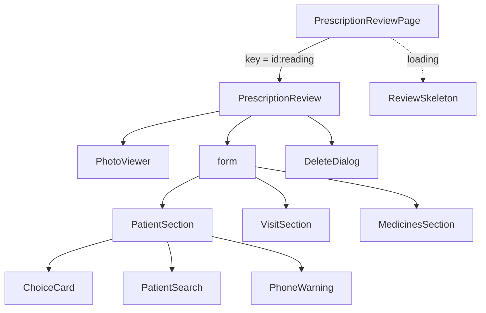

# 31 — `pages/PrescriptionReviewPage.tsx` (808 lines)

**Purpose:** the dentist's workspace — photo viewer beside an editable form pre-filled by the AI;
patient matching; save/discard/re-read; share once filed. **Route:** `/prescriptions/:id`.
**Calls:** `usePrescription`, `useSavePrescription`, `useExtractAgain`, `useDeletePrescription`,
`usePatients`, `reviewSchema`/`toFormValues`/`toSaveInput`/`isUncertain`, `SharePrescription`.



## Top level (69-95)

- 69-70: `selectClass` for native selects.
- 72-95: `PrescriptionReviewPage` — `usePrescription(id)`; skeleton; 404/error state; then
  `<PrescriptionReview key={`${id}:${reading}`} …/>` — remount when reading finishes so
  `useForm({ defaultValues })` picks up extracted values (`03-react.md` §3.9).

## `PrescriptionReview` (97-275)

| Lines | Code | Explanation |
|---|---|---|
| 98-106 | `user`, `navigate`; `editable = can(user,'clinical:edit')`; `canScan`; `isDraft`; `reading`; `canDelete = isDraft ? canScan : user.role === 'admin'`; `uncertain = p.extracted?.uncertain_fields ?? []` | derived permissions mirror the backend rules (UX only) |
| 108-111 | `useForm<ReviewValues>({ resolver: zodResolver(reviewSchema), defaultValues: toFormValues(p) })` | |
| 112-114 | save / extractAgain mutations, delete dialog state | |
| 116-133 | `onSubmit`: `save.mutate(toSaveInput(values), …)`; success → toast with "Scan next" action + navigate to patient; error → `patient_code_taken` to field, else toast joining message + field messages | |
| 135-141 | `check(path)` → warning "Check" badge if draft and path uncertain | passed down to sections |
| 145-161 | header: title/description differ for draft vs filed; Back (to patient or list); Share buttons when filed | |
| 163-175 | two-column grid on `lg` (5fr/7fr); photo column sticky; "Scanned by … · Filed by …" provenance line | |
| 177-190 | reading banner (`role="status"`) | |
| 192-197 | receptionists on a read draft: "awaiting dentist" note | |
| 199-226 | extraction error box with "Read again" (drafts, scan permission); spinner icon while pending | |
| 228-233 | "some fields were hard to read" notice | |
| 235-239 | `<fieldset disabled={!editable \|\| reading}>` wrapping the three sections | native disabling of all inputs |
| 241-263 | footer: Discard/Delete (if allowed) on the left, Save / Save changes (if editable) on the right; disabled while saving or reading | |
| 267-272 | `DeleteDialog` navigating to the patient or list after deletion | |

## `PatientSection` (284-452)

```tsx
289   const choice = form.watch('patientChoice')                 // re-render on change
292   const [picked, setPicked] = useState<PatientRef[]>([])       // patients chosen via search
294   const options = [
295     ...(p.patient ? [p.patient] : []),                         // the filed patient
296     ...p.patient_matches.map((m) => ({ ...m.patient, reasons: m.reasons })),
297     ...picked,
298   ].filter((o, i, all) => all.findIndex((x) => x.id === o.id) === i)   // de-duplicate by id
301   const choose = (id: string) => form.setValue('patientChoice', id, { shouldDirty: true, shouldValidate: true })
303   // `phone` is undefined when unknown (a bare PatientRef), null when the patient has none.
304   const chosenWithoutPhone = options.find((o) => o.id === choice)?.phone === null
305   const newPatientPhone = form.watch('newPatient.phone')
```
Render: hint when matches exist (313-315); a custom **radio group** of `ChoiceCard`s with reason badges
and phone/age (318-349); "New patient" card; choice error (351-355); missing-phone warning for an
existing patient (357) — reminders need a phone; new-patient fields with Check badges (359-427)
including a missing-phone warning under the phone input (399-401); "Choose another/existing patient"
link toggling `PatientSearch` (429-448).

## Small components

- `PhoneWarning` (454-461): amber text + `PhoneOffIcon`.
- `ChoiceCard` (463-495): `<button type="button" role="radio" aria-checked>` with a custom check dot —
  accessible custom radio.
- `PatientSearch` (497-553): local `q`; `usePatients({ q: search, page_size: 5 }, search.length >= 2)`
  (enabled only from 2 chars); results list buttons call `onPick`; Cancel (X) button; `autoFocus`.
  ⚠️ No debounce here (each keystroke ≥ 2 chars fires a request; cancellation via `signal` and
  `keepPreviousData` soften it).

## `VisitSection` (555-608)

Date inputs (`type="date"` gives `YYYY-MM-DD` strings that match the schema) for visit and follow-up;
textareas for chief complaint, diagnosis, procedures ("one per line" hint). Each has a `check(...)`
badge.

## `MedicinesSection` (610-685)

`useFieldArray({ control, name: 'medications' })`; "Add medicine" appends an empty row; each row: name
input + remove button, then a 2/4-column grid of dosage/frequency/duration/instructions generated from
`(['dosage','frequency','duration','instructions'] as const).map(...)`, labels from `t.review[key]`,
`check(`medications.${i}.${key}`)` badges; advice and notes textareas at the end.

## `PhotoViewer` (687-749)

```tsx
688   const [zoomed, setZoomed] = useState(false)
689   const [index, setIndex] = useState(0)
690   const src = srcs[Math.min(index, srcs.length - 1)]     // clamp (string | undefined under noUncheckedIndexedAccess)
691   const turn = (by: number) => { setIndex((i) => i + by); setZoomed(false) }
```
Click image to toggle zoom (natural size inside a scrollable box vs fit-to-height); zoom button; page
navigation with "Page X of Y" (`aria-live`); "Open full" link (`target="_blank" rel="noreferrer"`).
Image URLs are authenticated API routes — cookies attach automatically.

## `DeleteDialog` (751-793) and `ReviewSkeleton` (795-808)

Delete confirm dialog using `useDeletePrescription`; skeleton mirrors the final two-column layout to
avoid layout shift.

## Q&A

**Q:** 🟢 Why is the form wrapped in a `<fieldset disabled>`?

**A:** One attribute disables every input inside for users who can't edit (receptionists) and while the
AI is still reading (`PrescriptionReviewPage.tsx:235`).

**Q:** 🟡 How do "Check" badges know which fields to flag?

**A:** The model returns `uncertain_fields` like `medications.1.frequency`; `check(path)` calls
`isUncertain(uncertain, path)` and renders a warning badge next to that field's label (`:135-141`).

**Q:** 🟡 Why does the component distinguish `phone === null` from `undefined`?

**A:** Options built from a bare `PatientRef` (picked via search) don't carry `phone` (undefined =
unknown); full `Patient` objects from matches have `phone: null` when missing — only then show the "no
phone" warning (`:303-304`).

**Q:** 🔴 What happens if reading finishes while a dentist is typing?

**A:** It can't: the fieldset is disabled while `reading` is true. When reading ends, the `key` changes
and the form remounts with extracted values — any earlier edits (impossible while disabled) would be
lost by design.

**Q:** 🟡 How is the custom radio group accessible?

**A:** A container with `role="radiogroup"` and `aria-label`, and each card is a `<button role="radio"
aria-checked>` — focusable and announced as radio options (`:319, 473-476`). (Arrow-key navigation, which
native radios have, isn't implemented.)

**Q:** 🟢 Where does the user go after saving?

**A:** To the patient's page (`/patients/:id`), with a toast offering "Scan next" (`:117-123`).

**Q:** 🔴 What would you refactor in this file first?

**A:** Split sections into `features/prescriptions/review/*` components with their own tests; extract a
shared `Select` component; debounce `PatientSearch`; move permission logic into a hook
(`usePrescriptionPermissions(p)`) shared with tests.
